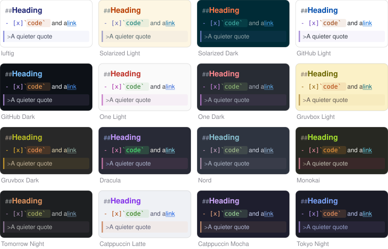

<p align="center">
  
</p>

# luftig

A small, very fast, native macOS Markdown editor for writing and thinking in plain text. Alone, or with an AI that edits the same file.

**One text view, no preview.** The Markdown source is what you edit, styled in place: headings are bigger, code blocks and quotes are marked, emphasis looks emphasised, the syntax characters are dimmed but stay visible and editable. What you see is the file.

Website: [luftig.polsys.net](https://luftig.polsys.net)

<p align="center">
  <a href="docs/screenshots/window-light.png"></a>
  <a href="docs/screenshots/window-dark.png"></a>
</p>

## What it does

- **Fast and tiny:** pure AppKit and Swift, no web view, no dependencies, a 1.4 MB executable. A 1 MB file is on screen, styled, in ~20 ms, a 20 MB file in ~30 ms; idle CPU is 0.02 %.
- **Working with an AI on the same files:** luftig watches open files. When another program - an agent, a build tool, or `git` - changes one, the new text appears within ~50 ms, keeping your selection and scroll position. Your own unsaved edits are merged in when the changes do not overlap, and a banner asks when they do. Nothing is ever written over a version you have not seen. **Settings → General** chooses the behaviour: reload automatically, ask first, or never reload.
- **No preview, just text:** the file is the document; there is no second rendering to keep in sync and nothing an agent cannot read back. CommonMark and GFM: headings, emphasis, links, lists and task lists, quotes, code blocks with their language, tables, footnotes and YAML front matter.
- **Writing help:** Return continues a list or a quote, Tab and Shift-Tab nest list items, the **Format** menu has a shortcut for every element, ⌘-click follows a link, the end of a document scrolls up to the middle of the window so you need not write at its bottom edge, and Typewriter Mode keeps the line you write on in the middle all the time.
- **Images in the text:** a line that holds only an image shows the image while the caret is elsewhere; drop image files into the text to link them. Images on your Mac by default, web images if you choose so.
- **Tables that line up:** while the caret is elsewhere, a table is drawn as a grid with wrapping cells; click into it and its Markdown shows, with the columns aligned while you type. Neither adds a single space to the file. **Format → Align Table** pads the table in the file too, for diffs, other editors and agents.
- **Panels around the text:** an outline of the headings to jump through the document, a word count and reading time, and a syntax bar that inserts Markdown with a click. All plain text in the scheme's dim colour, no boxes, no buttons, and each can be switched off.
- **Your look:** fonts and sizes for text, code and the panels, line spacing, column width and padding.
- **Colour schemes:** 16 built in, any Base16 scheme from a file, or your own from seven colour pickers.
- **Leaving the editor:** Copy as HTML or Rich Text, and Export as HTML, Rich Text or PDF, for the moment a document goes somewhere else.

<p align="center">
  
</p>

Full screenshots of every scheme: [lists and quotes](docs/screenshots/schemes/contact-sheet.png), [code and tables](docs/screenshots/schemes/contact-sheet-code.png).

## What it doesn't do

- **No preview.** There is no rendered view next to the text, and images are shown as their Markdown, not as pictures.
- **No sync or collaboration of its own.** luftig edits files on your Mac. To share or sync them, put them in iCloud Drive, Dropbox or a `git` repository.
- **Mac only.** It needs a Mac with Apple silicon and macOS 14 or later. There is no iPhone, iPad or Windows version.
- **No plugins, snippets or toolbar.** The Format menu and the syntax bar are all there is.
- **Some Markdown is styled, not resolved:** reference links are styled whether or not the reference exists, and Copy and Export as HTML follow the same rules. A table wider than the text column is aligned only as far as its columns fit, and one with a tab in it is shown as written.
- **Very long single lines are slow.** A line of several megabytes, such as an embedded image or minified JSON, makes typing inside it slow; the rest of the document is not affected.
- **Files over 200 MB and binary files** are refused.

The [manual](docs/MANUAL.md) lists every shortcut, setting and limit.

## Installation

You need a Mac with Apple silicon (M1 or later) running macOS 14 (Sonoma) or later.

1. Download `luftig-<version>.dmg` from the [latest release](https://github.com/bernorieder/luftig/releases/latest).
2. Open it and drag **luftig** into your **Applications** folder. The app is signed with a Developer ID and notarized, so macOS opens it without a warning.
3. Open a Markdown file with luftig, or open luftig and choose **File → New**.

With Homebrew:

```
brew install bernorieder/luftig/luftig
```

To make luftig the default app for `.md` files, select one in the Finder, choose **File → Get Info**, pick luftig under **Open with** and click **Change All**.

**Updating:** with Homebrew, `brew upgrade`. Otherwise download the new version and drag it into Applications, replacing the old one. Your settings and colour schemes are kept.

## Privacy

- **No network.** luftig has no account, no server and no network connection of its own. It reads and writes the files you open and the images they show, and nothing else. The only time it touches the network is when you click a link, which opens in your browser, or, if you choose so in Settings → General → Images, to download the web images your documents show.
- **No tracking.** No analytics, no crash reports, no telemetry.
- **Your files stay as they are.** The character encoding and line endings a file came with are written back unchanged.
- **On your Mac.** Your settings are stored in `~/Library/Preferences/com.bernorieder.luftig.plist`, and imported and custom colour schemes in `~/Library/Application Support/com.bernorieder.luftig/`.

The [privacy policy](https://luftig.polsys.net/privacy.html) has the details.

## Uninstalling

With Homebrew, `brew uninstall --zap --cask luftig` removes the app, its settings and its colour schemes.

Otherwise, quit luftig and move it from Applications to the Trash. To remove its settings and colour schemes too, delete `~/Library/Preferences/com.bernorieder.luftig.plist` and the folder `~/Library/Application Support/com.bernorieder.luftig`.

## Problems and ideas

Please open an issue on [GitHub](https://github.com/bernorieder/luftig/issues).

## For developers

- [Building and releasing luftig](docs/building.md): building with the Command Line Tools alone, the tests, signing, notarizing and the Homebrew tap.
- [How luftig works](docs/how-it-works.md): the technical choices in plain words, and where to read on.
- [Architecture](docs/ARCHITECTURE.md): the design, the data flow, a map of the code and the pitfalls.
- [Colour schemes](docs/color-schemes.md): the palettes, their sources and licences, and the legibility rules.

## License

luftig is released under the [MIT License](LICENSE).

## Credits

The built-in colour schemes use the palettes of Solarized (Ethan Schoonover), GitHub Primer, Atom's One themes, Gruvbox (morhetz), Dracula, Nord (Arctic Ice Studio and Sven Greb), Monokai (after Wimer Hazenberg), Tomorrow Night (Chris Kempson), Catppuccin and Tokyo Night (enkia, and folke's tokyonight.nvim). They keep their authors' licences, listed with their sources in [docs/color-schemes.md](docs/color-schemes.md).
