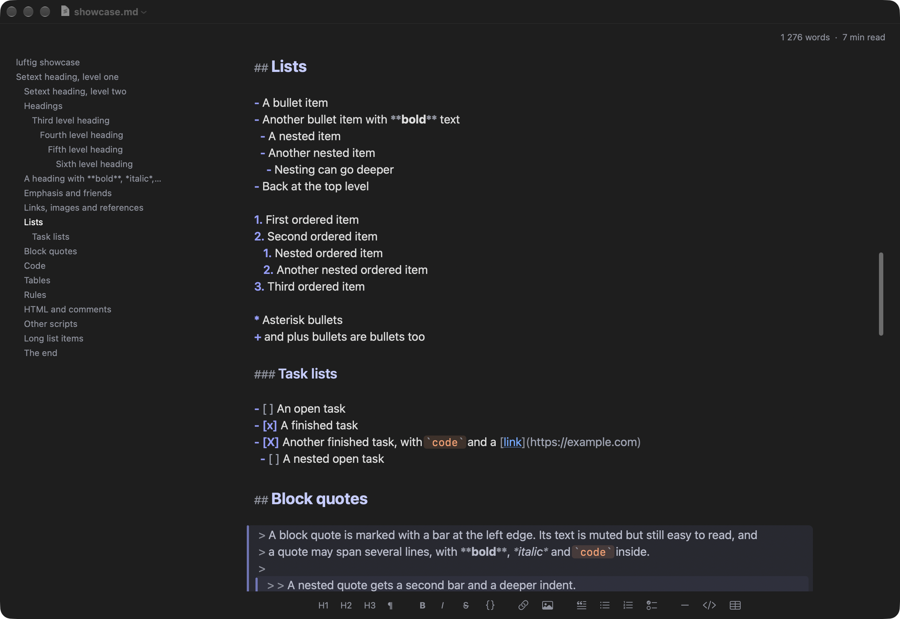
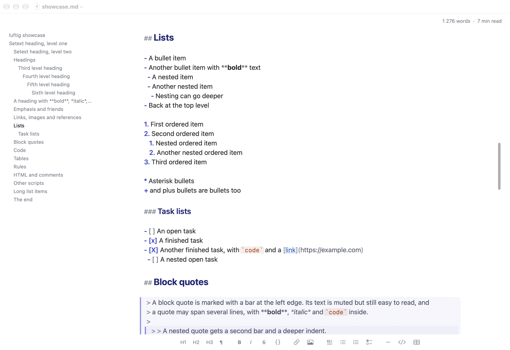
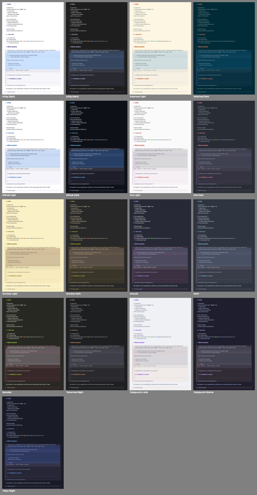
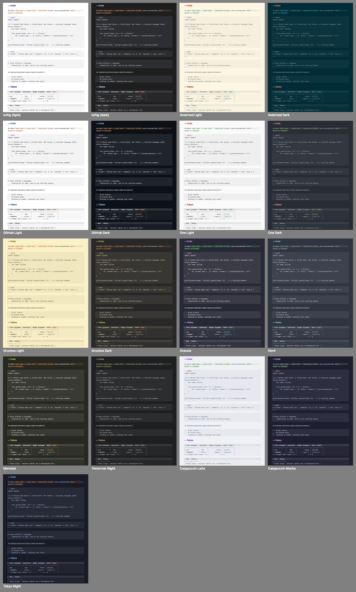

# luftig

A small, very fast, native macOS Markdown editor for writing and thinking in plain text - alone, or with an AI that edits the same files.

**One text view, no preview.** The Markdown source is what you edit, styled in place: headings are bigger, code blocks and quotes are marked, emphasis looks
emphasised, the syntax characters are dimmed but stay visible and editable. What you see is the file.




## Why

* **Fast and tiny.** Pure AppKit and Swift, no web view, no dependencies, a 1.4 MB executable. A 1 MB file is on screen, styled, in ~20 ms, a 20 MB file in
  ~30 ms; a keystroke costs 2-3 ms in a 200 KB and in a 10 MB document alike; idle CPU is 0.02 %.
* **Made for working with an AI on the same files.** luftig watches every open file. When another program - an agent, a build tool, `git` - changes it,
  the new text appears within ~50 ms by minimal edits, keeping your selection and scroll position; your own unsaved edits are merged in when the changes do not
  overlap, and a banner asks when they do. Nothing is ever written over a version you have not seen. Settings > General chooses the behaviour: reload
  automatically, ask first, or never reload.
* **No preview, just text.** The file is the document; there is no second rendering to keep in sync and nothing an agent cannot read back. Copy as HTML
  or Rich Text and Export as HTML / Rich Text / PDF are there for the moment a document leaves the editor.
* **Deep visual customization for distraction-free writing.** Fonts (text and code), size, line spacing, column width, 16 colour schemes plus any Base16
  scheme from a file, and one padding number that sets every gap in the window. Around the text, if you want them: an outline of the headings, a word count
  with the reading time, and a syntax bar that inserts Markdown with a click - all plain text in the scheme's dim colour, no boxes, no buttons. Typewriter
  Mode keeps the line you write on in the middle of the window.

## Markdown

CommonMark and GFM, styled as you type and incrementally (a 731-case conformance suite backs the lexer): ATX and setext headings, paragraphs with hard breaks,
emphasis, strikethrough, inline code, links, images, autolinks and bare URLs, reference links, footnotes, block quotes (nested), bulleted / numbered / task lists
with hanging indent, fenced and indented code blocks with the language, tables, horizontal rules, front matter, HTML blocks and inline HTML, backslash escapes and
entities. Lists continue on Return (the next bullet or number, an unchecked task box), Tab and Shift-Tab nest and un-nest items. ⌘-click follows a link: a web
address in the browser, a Markdown file in luftig at its anchor, `#heading` in this document. The Format menu has a shortcut for every element of the syntax bar
(⌘B, ⌘I, ⌘K, ⇧⌘1 ...). Right-to-left paragraphs are right-aligned.

## Colour schemes

The default follows the system appearance, light and dark; the other 15 are well-known editor themes (Solarized, GitHub, One, Gruvbox, Dracula, Nord, Monokai,
Tomorrow Night, Catppuccin, Tokyo Night), every text colour kept legible on every surface by a deterministic adjustment ([docs/color-schemes.md](docs/color-schemes.md)).
Import Scheme… in the Settings takes any Base16 YAML file.




## Settings

luftig > Settings… (⌘,) is one small window with a live preview and three screens, every control applied at once to every window:

| Screen | What is there |
|---|---|
| General | Open files in tabs. When the file changes on disk: reload automatically, ask first, never reload. Continue lists on Return |
| Text | Colour scheme (and Import Scheme…), text font, code font, size, line spacing (or automatic), column width |
| Layout | Which elements are shown (outline, syntax bar, word count, reading time), the padding (one number for every gap), the panes' font, size and opacity, outline wrapping and spacing |

## Build and install

macOS 14 or later, Apple Silicon. Builds with the Xcode Command Line Tools alone (Swift 6 toolchain, no Xcode):

```sh
Scripts/build-app.sh                            # release build -> build.noindex/luftig.app (ad-hoc signed, verified)
cp -R build.noindex/luftig.app /Applications/   # install
```

The signature is ad hoc, so macOS may ask once more for folder access after a rebuild; a copy that came through a browser or AirDrop needs
System Settings > Privacy & Security > Open Anyway (or `xattr -dr com.apple.quarantine`). luftig never makes itself the default app for `.md`: Finder > Get Info
> Open with > Change All does that.

## Technical choices

* AppKit and TextKit 1 with non-contiguous layout, one `NSTextView`: the only text engine that keeps a 10-20 MB file scrolling without a hang, with its own
  layout manager for the bands, bars and pills. Styling is lazy (what is on screen plus a margin) and incremental (a keystroke restyles its paragraph).
* `NSDocument` for the rest: open / save / autosave in place / undo / tabs / restoration / Find. Files are read with `read(2)`, encodings and line endings are
  written back byte for byte, the external-change policy sits on kqueue plus the file presenter.
* The whole thing is tested headless: 111 scenarios with ~4,200 checks (the document layer, the editor with real key events, pixels, colour contrast, memory,
  timing budgets) plus 1,900 lexer checks. `swift run -c release mdkit-checks`, `Scripts/build-app.sh --selftest`, then `build.noindex/luftig-SelfTest.app/Contents/MacOS/luftig-SelfTest --selftest all`.

Everything else - every shortcut, every setting in detail, the reload matrix, the look on macOS 26, the limits and how each number was measured - is in
[docs/MANUAL.md](docs/MANUAL.md); the design and the pitfalls are in [docs/ARCHITECTURE.md](docs/ARCHITECTURE.md).

## License

MIT, see [LICENSE](LICENSE). The colour schemes keep their authors' names and licences ([docs/color-schemes.md](docs/color-schemes.md)).
