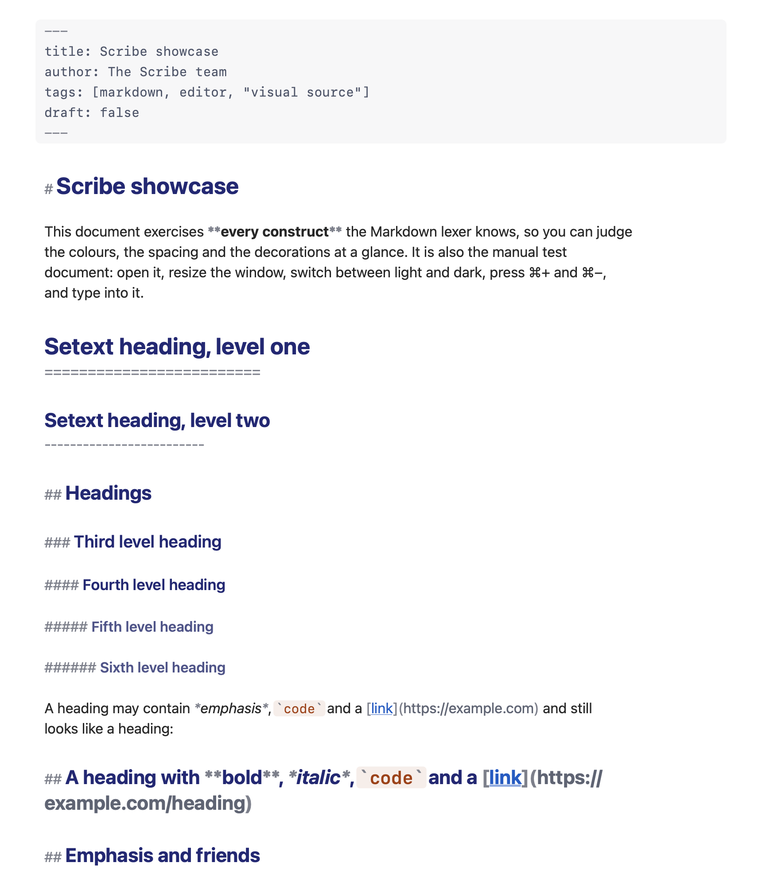
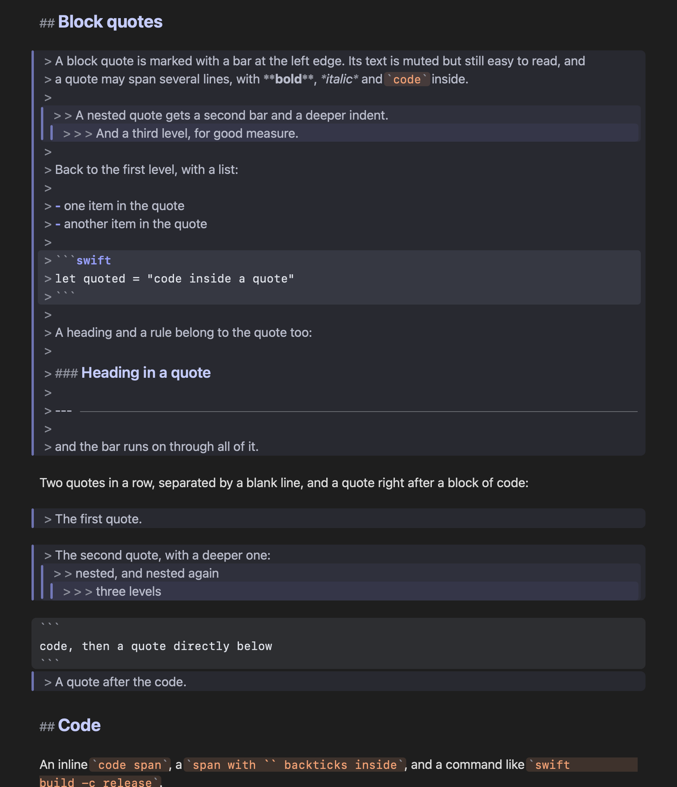
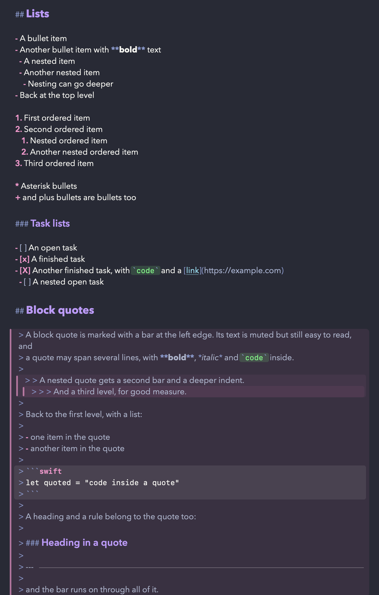
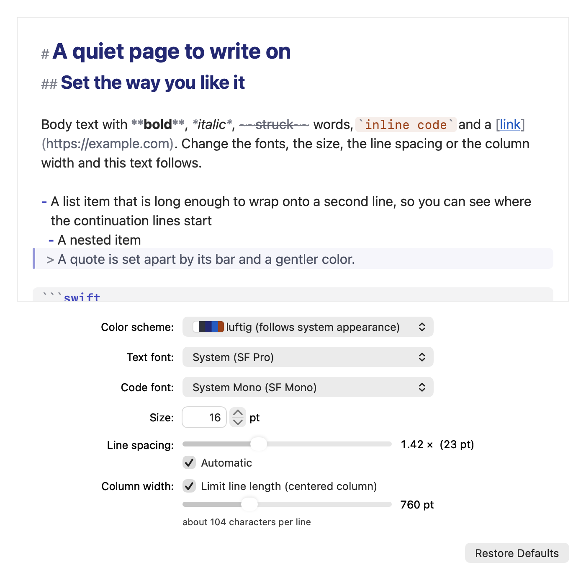
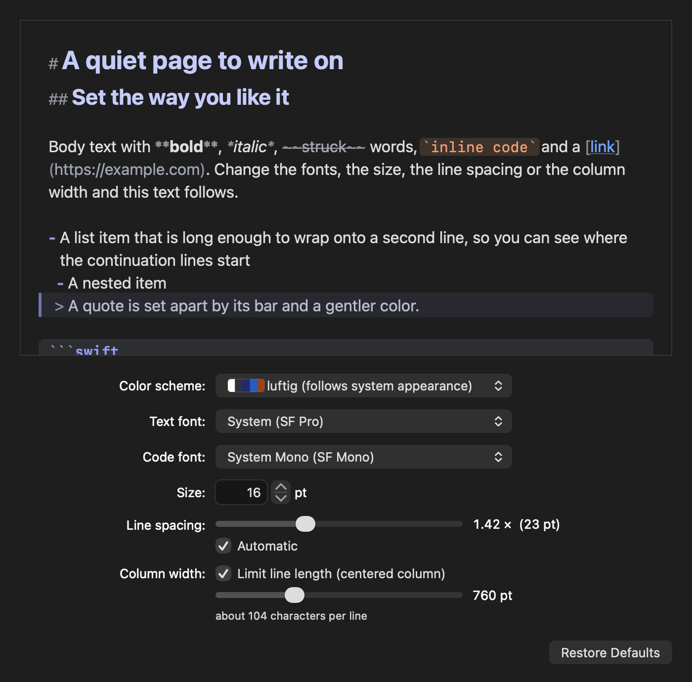
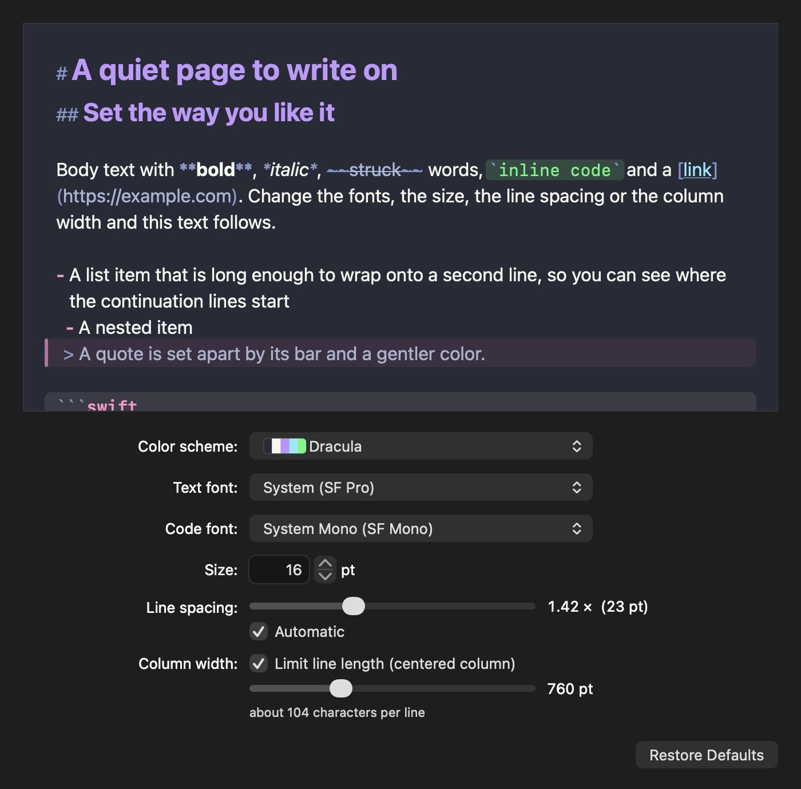
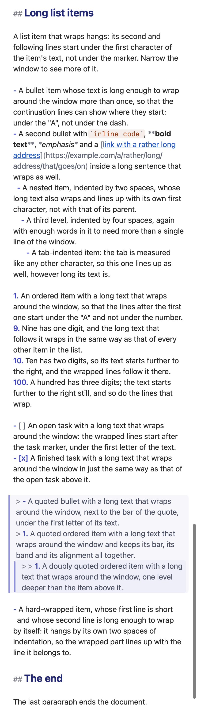
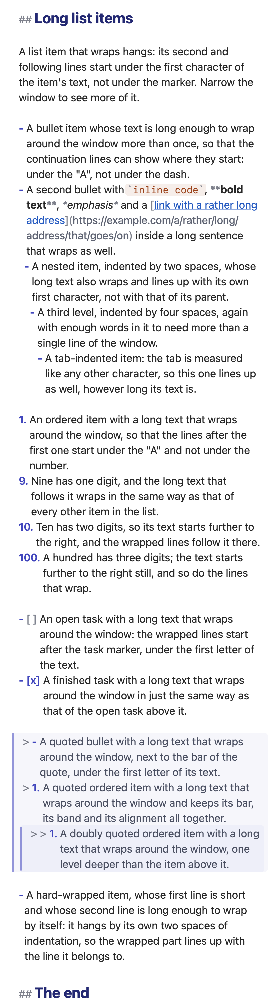

# luftig: the manual

The long version of the README: everything about luftig, section by section. (The README itself is the short introduction.)

A small, very fast, native macOS Markdown editor. **One text view, no preview.** The Markdown source is edited
directly and styled in place: headings are a bit bigger, code blocks and block quotes are visibly marked, emphasis
looks emphasised, syntax characters are dimmed but stay visible and editable.





* Pure AppKit / Swift, no web views, no SwiftUI text editing, no dependencies. ~1.06 MB executable.
* `NSDocument` based: Open / New / Save / Save As, Open Recent, autosave in place, undo, system tabs, window restoration,
  title bar with proxy icon and edited dot, native Find bar, light and dark mode.
* **Auto-reload**: when another program (a build tool, an agent, `git`) changes the open file, luftig shows the new text
  within ~50 ms, keeping your selection and scroll position.
* **Settings** (⌘,): fonts for text and code, size, line spacing, column width and 16 colour schemes (the default and 15 well-known editor
  themes), all applied live to every window; wrapped list items hang (their second and following lines start under the text of the item).
* **Around the text, if you want them** (View menu, remembered): an outline of the headings on the left (click one to go there; the section you are
  in is a little stronger), the word count at the top right (the selection's count while there is one), and a syntax bar at the bottom that shows the
  result of each element (H1 H2 H3 ¶, **B** *I* ~~S~~ and symbols for code, link, image, quote, lists, task, rule, code block, table) and inserts or
  toggles that Markdown around the selection or on the current lines (undoable). Plain text in the scheme's dim colour on the page, nothing that
  looks like a button, no titles; their font, size and opacity are settings.
* **Fast**: a 1 MB file is on screen, styled, in ~20 ms, a 10 MB file in ~25 ms, a 20 MB file in ~32 ms (warm; ~57 / 63 ms in a
  fresh process; ~3.5 ms of each is the current system look, see "Look on macOS 26 and later"). A key press costs 2-3 ms including restyling and redraw, in a 200 KB and in a 10 MB document alike. Idle CPU
  is 0.02-0.04 %. Changing a setting or the colour scheme restyles and repaints a 10 MB document in ~70 ms (1 MB: ~20 ms). Cold launch to the first window is ~180 ms (median since process start, p90 ~190-200 ms; measured with the classic look, the current one adds ~7 ms to the first window, the launch itself was not re-timed) on the machine it was
  measured on: that misses the 150 ms goal, but an app with an EMPTY AppKit window needs 162-182 ms in the same runs (ARCHITECTURE.md,
  section 5, has every number and how it was measured). Memory stays flat over repeated opens and reloads of big files.

macOS 14 or later (developed and measured on Apple Silicon, arm64 only: `Scripts/build-app.sh` builds for the machine it runs on;
a separate `swift build --arch x86_64` compiles and passes the functional self-test scenarios under Rosetta, native Intel hardware
was not available). Builds with the Xcode Command Line Tools only, no Xcode needed; `Package.swift` needs a Swift 6 toolchain
(swift-tools-version 6.0: the tools of Xcode 16 or later; built here with Swift 6.4).

## Build, run, install

```sh
Scripts/build-app.sh                  # release build  ->  build.noindex/luftig.app   (ad-hoc signed, verified)
open build.noindex/luftig.app                 # run it
cp -R build.noindex/luftig.app /Applications/ # install  (or ~/Applications)
```

(The build folder is called `build.noindex` so that Spotlight skips it: Spotlight registers every app bundle it indexes with Launch Services, and
with two copies of luftig known to it the Finder's "Open With" showed both as "luftig (1.0.0)". The installed copy is the only one Launch Services sees.)

`Scripts/build-app.sh --help` lists the options (`--debug`, `--out DIR`, `--scratch-path DIR`, `--no-sign`, ...). The script
runs `swift build -c release`, assembles `Contents/{MacOS,Resources,Info.plist}`, copies the committed icon, signs ad hoc and
verifies the result (it also checks that the shipping binary contains no test code, and refuses to build if it does). It works
from any directory, from a path with spaces, and never writes into the source tree. `Scripts/test-build-app.sh` tests the script
itself in a few seconds (stub compiler, no luftig build).

Notes for the first install:

* The signature is *ad hoc*: it changes with every build, so macOS may ask again for access to Documents / Desktop / Downloads
  after a rebuild. A stable self-signed identity avoids that.
* `CFBundleIdentifier` is the placeholder `local.luftig.luftig` (the app declares no exported file types of its own).
  Change it in `Resources/Info.plist` before you distribute the app.
* luftig declares itself an editor for Markdown and plain text at *alternate* rank, and the rarer Markdown extensions (`.mkd`, `.mdown`, `.mkdn`, `.mdwn`, `.mdtxt`, `.mdtext`) by extension only, at rank *none*. It appears in Open With (for the rare extensions: Open With > Other...) and never becomes anybody's default by itself, and it never changes the system's idea of a file type. (With equal ranks Launch Services prefers the app that ran most recently - that is why the rare extensions are rank none.) To make it your Markdown editor: Finder > Get Info > Open with > luftig > Change All.
* **Gatekeeper.** `spctl --assess` rejects the build (ad-hoc signature, not notarised), but Gatekeeper only assesses files that carry
  the `com.apple.quarantine` flag. A bundle you built yourself and copied with `cp -R` or Finder has none and starts without a
  question. A copy that came through a browser, AirDrop or a chat app is quarantined and macOS refuses to open it (the dialog says
  Apple could not verify the app): approve it once under System Settings > Privacy & Security > Open Anyway, or run
  `xattr -dr com.apple.quarantine /Applications/luftig.app`. (The Gatekeeper dialog itself was not exercised here: it needs the GUI.)
* The app is not sandboxed and asks for no entitlement. Opening files in Documents / Desktop / Downloads / iCloud Drive can make macOS
  ask once for access to that folder (luftig watches the folder of an open file to notice atomic replaces).
* luftig has no help book: the Help menu has no item of its own (AppKit adds its search field to it).
* **Look on macOS 26 and later.** The executable is stamped `minos 14.0`, SDK `27.0` (`Package.swift`, `linkerSettings`:
  `-Xlinker -platform_version -Xlinker macos -Xlinker 14.0 -Xlinker 27.0`, for the shipping and the self-test build alike; SwiftPM alone records
  the deployment target as the SDK version, and macOS 26 and later then draw the app in the classic style). With the stamp the current system
  design applies: a 32 pt title bar, 17 pt scrollers, flat translucent banner buttons, the new find bar, alerts and Settings controls (smaller
  sliders, taller pop-ups, a hosted stepper), and the window background of the Settings window is white instead of grey. The deployment target is
  unchanged (macOS 14 and 15 draw what they always drew) and the shipping executable has the very same code as the classic one (1,063,232 bytes either way;
  disassembly and section sizes compared: apart from the SDK field and the UUID, only the lengths of the build directory's path strings differ): the editor itself is untouched (every editor render is
  pixel-identical, TextKit 1 and our layout manager are still in place, the text starts below the title bar and nothing is painted over the first
  line: `look-editor`). The price, measured in a fresh
  process, interleaved with a classic build of the same source (n = 8): the first window +6.5 ms (55.7 vs 49.2 ms), the first find bar +9 ms and
  +12 MB, the first Settings window +29 ms (124 vs 95 ms; the second one is instant), the first alert -6 ms; and every further document window
  costs ~3.5 ms more to open (a 1 MB file on screen in 20.1 instead of 16.5 ms, 10 MB 24.7 instead of 21.4 ms: still far inside the budget),
  with ~4 MB more memory. AppKit adds a 6 pt inset below the text
  (clip view `contentInsets.bottom`), so the last line sits 6 pt higher when you scroll to the end. **To switch the new look off again, delete the
  `linkerSettings:` argument of the luftig target in `Package.swift`** (one block, commented there); `Scripts/build-app.sh` then reports the classic
  stamp, `look-stamp` fails on purpose, and `screenshots/classic-look/` shows what the classic chrome looked like. What the headless renders
  cannot show: the title bar and window frame, the tab bar, the full-screen chrome, the drawing of the new scrollers, the active controls and the
  caret of a key window, the menus (see `ARCHITECTURE.md`, pitfall 13).

## Tests

There is no XCTest on a Command-Line-Tools-only machine, so the tests are plain executables with exit status 0/1:

```sh
swift run -c release mdkit-checks                  # the Markdown lexer: 1932 checks (incl. a 731-case CommonMark / GFM suite), exit status != 0 on failure
swift run -c release mdkit-checks --fuzz 250000 7  # differential fuzzing (edits, seed); --bench, --conformance, --unicode-class, --show '<text>'

bash Scripts/test-build-app.sh                     # the build script itself (icon, test-code guard, --out safety, the executable's minos / SDK stamp), ~8 s
Scripts/build-app.sh --selftest                    # -> build.noindex/luftig-SelfTest.app (separate bundle id, same code + test hooks)
bash Scripts/test-lifecycle.sh                       # launch / Dock click / quit / restoration through Launch Services, ~45 s, hidden
build.noindex/luftig-SelfTest.app/Contents/MacOS/luftig-SelfTest --selftest list
build.noindex/luftig-SelfTest.app/Contents/MacOS/luftig-SelfTest --selftest all           # every scenario (96, 3,400 checks), ~9 minutes, headless; run it alone
build.noindex/luftig-SelfTest.app/Contents/MacOS/luftig-SelfTest --selftest open-perf,typing,idle,memory   # the numbers
```

The scenario families: the document layer (`reload-*`, `dirty-*`, `save-gate`, `deleted-moved`, `auditdoc-*`: property tests, bytes in = bytes out,
coordinated writers, a model-based fuzz of the clean / dirty / conflict / deleted states), the editor (`audit-*`: real key events, clipboard, IME,
appearance, leaks, lazy styling under random scrolling / editing / resizing), how it looks (`visual-*`: metrics, bands, selection, right-to-left, the contrast of
every colour in four variants, partial redraw == full draw), robustness (`monkey`, `leaks`, `hostile`, `resource-policy`, `storm`, `reader-race`,
`robust-regress`; `Scripts/robust-soak.sh` runs the heavy versions) and performance (`perf-guard`, a regression guard with generous budgets that skips itself
on a loaded machine, and the `perf-*` measurement scenarios). The `settings-*` scenarios cover the Settings window and what it controls (see "Settings" below): preferences and hostile `UserDefaults`, two windows following every setting, the
attribute oracle with non-default fonts, line boxes for 12 families x 3 factors x 3 sizes, synthetic italic / bold, a family that is not installed, the window's controls (driven with `sendAction` /
`performClick`), the preview == a fresh restyle, light / dark x every scheme, Restore Defaults == the baseline look byte for byte, and the budgets with non-default settings. The `schemes-*` scenarios cover the colour schemes
(every role of every scheme, the contrast of every colour on every surface, `Palette.apply` x 60, the selection on pixels, the default scheme's golden colours), the `indent-*` scenarios the hanging indent (an independent
oracle of the head indent from the stored fonts, the real layout of every wrapped line, 2 x 1000 random edits against a fresh lex). The `matrix-*` scenarios run the three features TOGETHER, which no single one of them
could: the pixel checks of the decorations and the hanging indent under 5 combinations of colour scheme x font family x size x line spacing x column width, the Settings preview against an editor of the same width
(line fragments and pixels), and Print... under a dark scheme. The `look-*` scenarios cover the look on macOS 26 and later (the SDK 27.0 stamp, see "Look on macOS 26 and later" above): the stamp and the chrome it brings (`look-stamp`: fails on a classic build on purpose), the editor under it (`look-editor`: TextKit 1 kept, the first line fully visible
and not painted over, the last line reachable, a legacy scroller, the find bar), the conflict banner with its translucent buttons (`look-banner`: geometry, and every title legible on pixels, 2 styles x 2 appearances x 3 widths) and the Settings window under the new control metrics
(`look-settings`, and `look-settings-fixed`: its layout through every control's range in light, dark, a dark scheme on a light system and a light scheme on a dark system); `look-render` (PNGs of the banner, find bar, legacy scroller, alerts, icon), `look-defaults` and `look-cost` are internal tools for comparing two builds. The `fix-*` scenarios guard defects found in daily use: `fix-settings-layout` (no control of the Settings window moves and the window keeps its size, whatever a value, a note or a font name says), `fix-settings-size` (the size field shows the size in use while it is being edited), `fix-settings-drag` (a slider dragged over a 10 MB document restyles the editors at a bounded rate and always ends on the final value) and `fix-scroll` (per-step budgets for scrolling a real document in a full-screen-sized window) and `fix-scroll-path` (the editor opts out of AppKit's responsive scrolling, so a two-finger scroll takes the same synchronous path as the scroller's knob: the overdraw of the responsive path laid out screens of fresh text ahead and redrew everything on every height revision, which was the choppy full-screen scrolling); `fix-scroll-bench` is the measurement behind it (`--input f.md [--fonts default|fira|serif] [--size WxH] [--spell]`). `perf-guard` and the timing checks need a machine that is not busy: they skip or fail on one.

The `audit-shell-*` scenarios review the app shell: menus (dead items, key equivalents, validation in six document states),
Info.plist, icon and the file extensions it claims, preferences, and the runner itself (`--workdir` refuses a folder that has files
in it). `Scripts/test-lifecycle.sh` drives a COPY of the self-test bundle (own bundle id, never a default handler) through Launch
Services (`open -g -j -n -a ... --args -LuftigCommands file`, see `SelfTest/SelfTestHooks.swift`) and checks what the user sees at
launch: one untitled window, no second window for the same file, a Dock click with and without windows, an edit surviving an
immediate quit, window and draft restoration, the read-only sheet. It needs the real `AppDelegate`, which the in-process runner
replaces with its own.

The self-test runs the real application code (real `NSDocumentController`, `MarkdownDocument`, window, text view, lazy styler)
without a single window reaching the screen (activation policy `.prohibited`, windows never ordered front, alerts and save panels
trapped). External writers are real child processes (`/bin/sh`). The `SelfTest/` sources are compiled only with
`-DLUFTIG_SELFTEST`; the shipping binary contains none of them.

Render the real editor window to a PNG (for visual review), never touching the input file:

```sh
luftig-SelfTest --selftest render --input showcase.md --out /tmp/shot.png --appearance dark \
                [--width 860 --height 1000] [--scroll-to-char N | --scroll-to-text "## Heading"] [--select A:B | --select-text FROM:TO]
                [--active-selection] [--increase-contrast] [--font-size 18] [--strip-height H] [--conflict]
                [--scheme ID] [--body-font Georgia] [--code-font Menlo] [--line-spacing 1.6] [--column-width 600]
```

`--increase-contrast` renders the palette AppKit's "Increase contrast" switch selects; `--strip-height H` draws the view in strips of H points and stitches them
(what AppKit paints while scrolling and when the caret blinks: it must equal the full draw, see the `visual-redraw` scenario). `screenshots/regenerate.sh`
rebuilds the gallery.

`showcase.md` exercises every Markdown construct; it is the manual test document and the source of the screenshots in
`screenshots/`.

## Keyboard shortcuts

| | |
|---|---|
| ⌘N / ⌘O / ⌘W | New / Open… / Close window |
| ⌘S / ⇧⌘S | Save / Save As… (autosave writes the file by itself 3 s after you stop typing) |
| ⌥⌘R | File > Reload from Disk (asks first if you have unsaved edits; undoable) |
| ⌘Z / ⇧⌘Z | Undo / Redo |
| ⌘F, ⌘G / ⇧⌘G, ⌥⌘F, ⌘E, ⌘J | Find, Next / Previous, Find and Replace, Use Selection for Find, Jump to Selection |
| ⌘, | luftig > Settings…: fonts, size, line spacing, column width, colour scheme (see "Settings" below) |
| ⌘+ / ⌘− / ⌘0 | View > Bigger / Smaller / Actual Size (applies to all windows, remembered; the Settings window follows). Bigger answers ⌘= as well as ⌘+ (= ⇧⌘= on a US keyboard) |
| View > Wrap to Readable Width | Centred column of at most 760 pt by default (the width is a setting), default on, remembered. The same switch as "Limit line length" in Settings |
| View > Toggle Spell Checking | Off by default (also Edit > Spelling and Grammar) |
| View > Show / Hide Outline, Word Count, Syntax Bar | The three elements around the text (all on by default, remembered, every window follows). Outline: the headings (ATX and setext, not inside code fences or front matter), indented by level, click = that heading at the top of the window with the caret on it. Word count: words are runs of text with a letter or digit (so `---`, `|`, `**` alone do not count), CJK one per character; "12 of 1,234 words" while something is selected. Syntax bar: H1 / H2 / H3 set that heading level (the same level again makes the line plain), ¶ strips heading, quote and list markers, B / I / S / code wrap the selection or unwrap it, link / image put placeholders you can type over, quote / list / numbered / task toggle the prefix on the selected lines, rule / code block / table insert on their own lines. Settings > Layout: the three switches again, the padding (one number of points for every gap), their font (the text font unless chosen), size (9 - 20 pt), opacity, wrapping of long headings in the outline, and the outline's row height |
| Format menu: ⇧⌘1 / ⇧⌘2 / ⇧⌘3 / ⇧⌘0, ⌘B, ⌘I, ⇧⌘X, ⇧⌘C, ⌘K, ⇧⌘K, ⌥⌘Q, ⌥⌘U, ⌥⌘O, ⌥⌘X, ⌥⌘-, ⌥⌘C, ⌥⌘T | Heading 1 / 2 / 3 / plain paragraph, bold, italic, strikethrough, inline code, link, image, quote, bulleted list, numbered list, task, rule, code block, table: the same edits as the syntax bar's elements (whose tooltips name the shortcut) |
| Return, Tab, ⇧Tab on a list or quote line | Return continues the list (the next bullet, the next number - the items below are renumbered when they were in sequence -, an unchecked task box, the quote's `>`); Return on an empty item outdents it or removes its marker; Tab nests the item under the one above, ⇧Tab un-nests it. Off with Settings > General > Continue lists on Return. Inside a code block the keys are the ordinary keys |
| ⌘-click on a link, ⌥⌘L | Follow the link under the mouse (or the caret: Edit > Open Link): a web address in the browser, a Markdown or text file in luftig (at its `#anchor`), any other file in its application, `#heading` in this document. Inline links, images, `<autolinks>`, bare `www.` / `https://` addresses and `[text][ref]` references through their definition |
| ⇧⌘T | View > Typewriter Mode: the line with the caret stays in the middle of the window. Remembered, every window follows |
| ⌥⇧⌘C / ⌃⇧⌘C | Edit > Copy as HTML (the selection's lines, or everything, as HTML source - also as plain text, so a text editor gets the source) / Copy as Rich Text (the same as RTF, for Mail, Pages, a chat) |
| ⌥⌘E, File > Export as Rich Text… / as PDF… | Export as HTML: a complete page with a small stylesheet in your fonts, light and dark. Export as Rich Text: the same content as an RTF file; Export as PDF: that rich text paginated on the Page Setup paper |
| View > Show / Hide Reading Time | "7 min read" (200 words a minute, rounded up) in the word count's row, next to the count or alone; off by default. Settings > Layout has the switch too |
| ⌃⌘F, ⌘M, ⌘H, ⌘Q | Full screen, Minimize, Hide, Quit |
| ⌃Tab / ⌃⇧Tab, View > Show Tab Bar | Switch tabs (⌘N opens a tab if "Prefer tabs" is set in System Settings) |
| ⌘P / ⇧⌘P | Print… / Page Setup… |

Not included on purpose: snippets, a preview pane, a toolbar.

## Settings

**luftig > Settings…** (⌘,) opens one small window, a singleton: choosing it again raises the same window, ⌘W closes it, its position is remembered. Every control
applies at once to every open window and is saved (no OK / Apply buttons); the live preview at the top is styled by the real theme and lexer with the
current settings, so fonts, size, spacing, column and colours change in front of you. Under the preview a switch chooses between three screens, remembered:
**General** (Open files in tabs: off by default, every file gets a window of its own; on, new files open as tabs of the front window. When the file changes
on disk: reload automatically - the default, see below -, ask first - a banner offers Reload from Disk / Keep My Version for every change and nothing is
merged -, or never reload - the change is not shown, saving over it asks first. Continue lists on Return: the list keys, see "Keyboard shortcuts"), **Text**
(everything about the text) and **Layout**, for the elements around the text (outline, syntax bar, word count, reading time): which of them are shown (the
View menu's switches, the other way to reach them; the reading time shares the word count's row), the **Padding** - one number of points, 0 to 50, that is every gap in the editor: between the
window's edge and the panels on the left and the right, between the outline and the text, and between the text and the sides of its own panel; the
vertical gaps are half of it - the frame at the top and the bottom, between the word count row and the outline and text below it, between the syntax
bar and the text above it (the bar sits under the text column, centred below the text; the outline runs on past it); at 0 everything touches, at 50 the editor floats,
and the gaps above the text viewport and the outline are always the same, so scrolled text starts level with the outline's first entry; the thing
the name is about (the gaps between the bar's symbols and the outline's row height stay put) -, their font ("Same as text font" unless you choose one),
their size (9 - 20 pt), their opacity (25 - 100 %, less = fainter), whether long headings in the outline wrap onto further lines instead of being
cut off, and the outline's row height (Outline spacing, 1 - 2.5 × the outline font's height; it is not part of the padding). 

Two things about windows: opening a file takes every other document out of full screen first, so the new one opens on the desktop and not inside
another file's full-screen Space (where macOS used to put it as a tab or as a second full-screen window); and there is only ever one luftig running:
a second copy that gets launched (a build next to the installed one, `open -n`) hands its files to the running one and quits.

| Setting | What it does |
|---|---|
| Color scheme | The luftig default (follows the system appearance) or a scheme from a well-known editor theme, grouped by family, each with a colour swatch. A scheme that is always light or always dark also sets the window's appearance (title bar, scrollers, find bar). **Import Scheme…** at the end of the list takes a [Base16](https://github.com/tinted-theming/schemes) YAML file (hundreds of editor themes come in that format, both the classic `scheme:` / `base00:` spelling and the newer `palette:` one): the file is copied into `~/Library/Application Support/local.luftig.luftig/Color Schemes/`, the scheme appears under "Imported" and gets the same legibility treatment as the built-in ones (page base00, text base05, markers base03, headings base0D, accent base0E, links base0C, inline code base0B, selection base02; light or dark from the file's variant or the page's luminance). To remove one, delete its file ("Show Imported Schemes in Finder") |
| Text font | Any installed family (each name shown in its own typeface); the default is the system font (SF Pro). Bold, italic and semibold come from the family's own faces; a family that lacks them gets a slanted (`.obliqueness`) or stroked (`.strokeWidth`) version of the regular face |
| Code font | Monospaced families only (inline code, code blocks, tables, front matter); the default is the system monospaced font (SF Mono). A tab in code is 4 columns of this font |
| Size | 9 to 40 pt: stepper and field. The same value as ⌘+ ⌘− ⌘0; headings (1.6 / 1.35 / 1.18 / 1.05 times) and code (0.9 times) keep their ratios |
| Line spacing | A multiple of the font size, 1.1 to 2.0. "Automatic" (the default) is the curve luftig always had (1.46 at 11 pt, 1.42 at 16 pt, 1.31 at 28 pt), so the default look is unchanged. The line box is never smaller than the tallest letters of the chosen fonts (ascent + descent): a tall family such as Zapfino raises it and the window says so |
| Column width | 480 to 1400 pt (default 760) with "Limit line length (centered column)", the same switch as View > Wrap to Readable Width; unchecked, the text uses the full window width. The window shows about how many characters per line that is |
| Restore Defaults | Everything above back to the default look (one click, one restyle) |

Stored in `UserDefaults` under `LuftigColorScheme`, `LuftigBodyFontFamily`, `LuftigCodeFontFamily`, `LuftigFontSize`, `LuftigLineHeightFactor`, `LuftigColumnWidth` and `LuftigReadableWidth`.
Hostile or stale values never crash and never leave the allowed range (a scheme id this version does not know reads as the default, a size from the future is clamped), and are
not written back. A font family that is not installed any more is drawn in the system font and its name stays saved, so the font is back when it is installed again (the pop-up
shows it as "not installed"). Render the window for review: `luftig-SelfTest --selftest settings-render --out /tmp/settings.png [--appearance dark] [--body-font Georgia] [--code-font Menlo] [--font-size 19] [--line-spacing 1.6] [--column-width 600] [--scheme id]`.




Known limitation: TextKit 1 adds a font's own *leading* on top of the fixed line box (measured: line height = box + leading, to the last digit). The system fonts have none, so the default
look is exactly uniform; Helvetica Neue has ~3 % of its size, Monaco 5-8 %, so with such a family a line can be up to that much taller than the box (never shorter, glyphs never overlap).

### Color schemes

16 schemes: the luftig default and 15 colour themes of well-known editors. The default is the palette luftig always had and follows the system (light, dark, Increase contrast); any other scheme is a fixed
light or dark look and sets the appearance of the whole app (title bar, scrollers, find bar, this window) to match. Every text colour of every scheme is checked for contrast against every surface it can sit
on (text 4.5:1, syntax markers 3:1, 7:1 and 4.5:1 with Increase contrast); where an authentic colour failed, only its lightness was moved, as little as possible, and `color-schemes.md` lists each change.
The palettes are the authors' own (hex values only, no code), read from their sites or repositories; sources, licences, the role mapping and the adjustments are in `color-schemes.md`.

| Scheme | | Palette from |
|---|---|---|
| luftig (default) | follows the system | luftig |
| Solarized Light, Solarized Dark | light, dark | Ethan Schoonover (MIT) |
| GitHub Light, GitHub Dark | light, dark | GitHub Primer primitives (MIT) |
| One Light, One Dark | light, dark | Atom's One syntax themes (MIT) |
| Gruvbox Light, Gruvbox Dark | light, dark | morhetz/gruvbox (MIT/X11 as the repository page states it) |
| Dracula | dark | Dracula Theme (MIT) |
| Nord | dark | Arctic Ice Studio / Sven Greb (MIT) |
| Monokai | dark | after Wimer Hazenberg, values of VS Code's Monokai (MIT) |
| Tomorrow Night | dark | Chris Kempson (MIT) |
| Catppuccin Latte, Catppuccin Mocha | light, dark | Catppuccin (MIT) |
| Tokyo Night | dark | enkia, values of folke's tokyonight.nvim (Apache-2.0) |


The Settings window under a forced scheme: a dark scheme on a light system, and the window follows it.



### Lists that wrap (hanging indent)

A list item that wraps hangs: its second and following lines start under the first character of the item's text, not under the marker. It applies to bullets (`-` `*` `+`), numbered items (`1.` `1)`, numbers of any
length, each width measured), task items (`- [ ]`, `- [x]`), items nested by spaces or tabs, quoted lists (`> - `, `> > 1. `), items that start with bold, code or a link, and hard-wrapped continuation
lines (a line that starts with spaces hangs by those spaces). The indent is measured in the fonts the characters really have, including the kerning between the last space and the first letter, so it follows the
text font, the size and the line spacing you chose, also while you type (`9.` becomes `10.`, `- ` becomes `- [ ] `, a tab nests an item) and after Restore Defaults. Not hung: headings, code blocks, tables, front
matter, HTML, rules, right-to-left lines (their paragraph is right-aligned), plain `> text` lines and paragraphs without indentation. The indent is capped at 10 times the font size.




## What happens when the file changes on disk

luftig watches every open file with kqueue (the file and its folder, so atomic replaces, rename-away-and-back and delete+recreate
are seen too), re-checks when the app or window becomes active and right before every save, and listens to the system's file
presenter callbacks as a safety net. The check is one `stat(2)` when nothing changed; a changed file is read, hashed and only
decoded when the bytes really differ (so `touch` or an identical rewrite never reloads).

* **Unmodified document**: the new text replaces the old one silently, by minimal edits (a line-level diff), so your selection and
  scroll position stay where they were (the line at the top of the window stays at the top). The undo history is cleared (its entries
  would refer to text that no longer exists). Typical latency 50 ms; a burst of writes is coalesced (a writer that touches the file
  20 times in a second causes 5-7 reloads, never 20).
* **Document with unsaved edits** (autosave keeps this window short, 3 s, but it can happen): luftig tries a three-way line merge
  of *your text*, *the text of the file when you started editing* and *the new file*. If the changes do not overlap, both survive,
  as ONE undoable edit, with a short info banner. If they overlap, nothing is overwritten: a banner offers **Reload from Disk**
  (undoable: Undo brings your text back) or **Keep My Version** (the next save replaces the file), autosave is held back silently
  (no stock "changed by another application" sheet at an arbitrary moment), and ⌘S / closing the window ask with a sheet.
* **File deleted or moved away**: after a short grace period (a move is reported within ~1 s) the banner says so, the window
  stays open with your text, is marked edited so closing asks, and autosave is held back (luftig must not resurrect a file you
  deleted on purpose). *Save Again…* writes it. If the file comes back, it is compared like any other change.
* **File becomes unreadable** (binary, > 200 MB): your text stays, saving is held back until you decide.
* **Settings > General > When the file changes on disk** chooses between this behaviour (Reload automatically), **Ask first** (every change, with or without unsaved
  edits, shows the banner with Reload from Disk / Keep My Version and nothing is merged or reloaded by itself) and **Never reload** (the change is not shown; the
  other version is remembered, so that autosave is held back and ⌘S or closing asks with the sheet: luftig still never writes over a version it was not told to).
* Network volumes (SMB/NFS/…) do not deliver kqueue events for remote changes: those files are polled every 2 s instead.
  *Not tested against real OneDrive / iCloud / File Provider folders* (they usually write under file coordination, which
  `NSDocument` handles by itself: luftig's own check has normally reloaded already and the system revert is a no-op).

Files are read with `read(2)` (never memory-mapped: a build tool truncating a mapped file would kill the process with SIGBUS).
Encodings are kept: UTF-8 (with or without BOM), UTF-16/32, Windows-1252 and Mac Roman are detected and written back byte for byte;
CRLF / CR files are shown with LF and written back as they were; mixed line endings are kept as they are.

## Known limitations

* TextKit 1 is Apple's older text engine (still fully supported). It was chosen over TextKit 2 because only TextKit 1 with
  non-contiguous layout has a reliable scroller and no hang on 10-20 MB files (docs/spike-textkit.md). Only two small files are
  engine specific.
* Right-to-left paragraphs (the first strong character is Arabic, Hebrew, ...) are right-aligned; the direction is decided per line. Quote, code, table and
  front matter lines stay left-aligned (their bar / band / markers are on the left).
* Hanging indent is a property of the LINE (it needs no list context, so incremental styling stays equal to a fresh lex): a paragraph line indented by three spaces hangs by those three spaces too.
  A prefix wider than 10 em hangs at 10 em, and a window narrower than the prefix at a large font size (a 40 pt font, a 360 pt window, 30 leading spaces) leaves no room for the text, as the first line of such a line already did.
* A text font without a semibold or bold face (Papyrus, Zapfino, ...) gets them faked with a stroke; AppKit then repaints the outermost anti-aliased pixel row of such glyphs only with a full repaint (a strip scrolled in
  on its own can miss it; 4-10 levels of one pixel row, not visible). Italic is faked by a slant. A family that is not installed is drawn in the system font and keeps its saved name.
* Printing prints plain text in a monospaced font on white paper, whatever the colour scheme (checked with a dark scheme and a dark system appearance).
* VoiceOver on very large files: AppKit's `accessibilityLine(for:)` is O(document size) (seconds at 20 MB). Normal sizes are fine.
* A single line of several megabytes is slow in any text engine: a keystroke INSIDE a line costs about 0.23 us per character (100 KB: ~40 ms, 1 MB:
  ~350 ms, 5 MB: ~2 s; elsewhere in the same document it stays at ~3.5 ms), and so does opening or scrolling to it. A base64 image or minified JSON in a
  Markdown file is the typical case. Lines beyond 64 K characters get no inline styling.
* Big documents with lots of non-Latin text (CJK, Arabic, Hebrew, emoji): the first click, keystroke or jump into the MIDDLE of a multi-MB document waits for
  AppKit's lazy font fallback (10 MB: 0.5-2.7 s, once; the next keystroke next to it takes 40 ms). Latin text is not affected (20 MB: 0.16 s). Under 1 MB nothing is noticeable.
* An open document whose file another tool replaces with a SYMBOLIC LINK keeps showing the text, but cannot be saved any more ("The file doesn't exist": a
  limit of NSDocument's safe save); Save As works. A symlink that is opened through Launch Services (`open -a`) is resolved to the real file first; what the Open panel
  hands over for a symlink was not checked.
* Undoing past a merged-in external change leaves a document that shows other text than the file but counts as unmodified; the next keystroke saves over the
  external line without asking (you did undo it).
* Lexer gaps (documented in `Sources/MarkdownKit/README.md`): reference definitions are not resolved (`[text][ref]` is styled
  whether or not `[ref]` exists), no multi-line inline HTML tags, no link destination on another line than its `]`, tables are styled but not
  aligned for you (they use a monospaced font so your pipes line up).
* Files larger than 200 MB and binary files are refused with an error. A file with unsaved changes is never overwritten silently,
  which also means the autosave of a conflicted document waits for your decision.
* Copy as HTML / Export as HTML follow the lexer, not a full Markdown parser: `[shortcut]` references stay text, footnote definitions become a paragraph, a
  quote inside a list item ends the list, and what the lexer does not resolve (see the lexer gaps above) is not resolved here either. Tab / Shift-Tab leave
  list items inside block quotes alone (their indentation sits after the `>`).
* Not exercised in the automated tests (they run headless, no key window): a real input method (IME), VoiceOver, the look of the
  active selection and the caret in a key window, live window resizing and trackpad scrolling, visible sheets and alerts, a real
  Dock click on minimised windows, real drag to the Dock icon. See ARCHITECTURE.md, "What is not verified".

## Layout of the repository

```
Sources/MarkdownKit/        Markdown lexer: text -> style runs, incremental, viewport-lazy (Foundation only; its own README)
Sources/MarkdownKitChecks/  mdkit-checks: expectation tables, invariants, differential fuzzer, benchmarks
Sources/luftig/             the app (see ARCHITECTURE.md for the file map)
Sources/luftig/SelfTest/    headless scenarios; compiled only with -DLUFTIG_SELFTEST
Scripts/build-app.sh        release / self-test bundle, ad-hoc signing, verification (test-build-app.sh, test-lifecycle.sh test it)
Resources/                  Info.plist, app icon (generated by make-icon.swift)
docs/                       DESIGN.md (brief + budget), ARCHITECTURE.md, color-schemes.md (the 16 schemes: sources, licences, adjustments), spike reports (spike-*.md and their code), showcase.md, screenshots/
```
