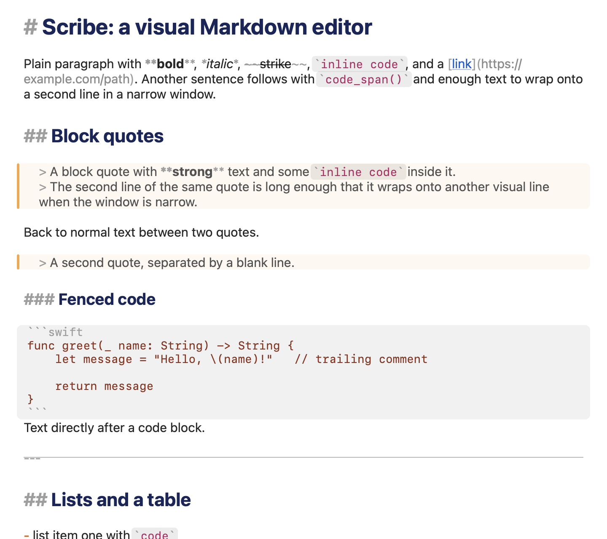
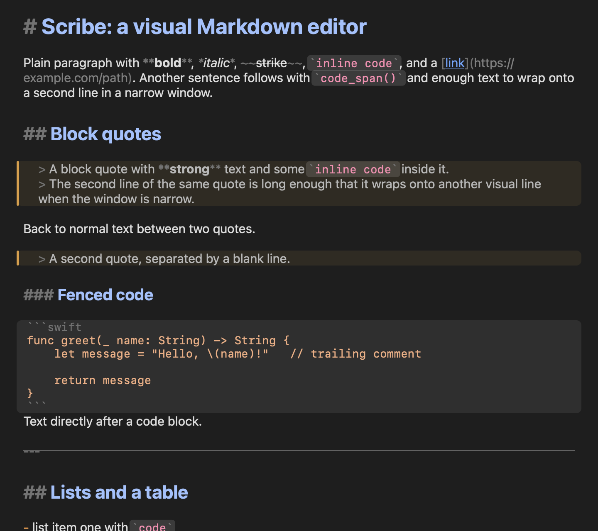

# Spike: text engine for the Scribe editor view (TextKit 1 vs TextKit 2)

All numbers in this document were measured on this machine (Apple M5 Pro, 18 cores, 64 GB, macOS 27.0.1, Swift 6.4,
Command Line Tools only) with **release builds** in a headless harness. Raw tables are in
`spike-textkit-code/results/`, the harness is in `spike-textkit-code/spike-harness/`, snapshots are in
`spike-textkit-code/snapshots/`, drop-in code is in `spike-textkit-code/*.swift`.

---------------------------------------------------------------------------------------------------------------------

## 0. Recommendation

**Ship TextKit 1 with non-contiguous layout** (`NSTextView(frame:textContainer:)` on an `NSLayoutManager` subclass with
`allowsNonContiguousLayout = true`), styled lazily in viewport slices, with uniform line heights, decorations drawn from
`NSTextView.drawBackground(in:)`, and the styled-range bookkeeping in `LazyStyler`. Do **not** use the TK1 default
(contiguous layout) and do **not** use TextKit 2 (the default of `NSTextView.scrollableTextView()`).

Why, in one paragraph: open, attribute application, typing and the visual marking are *not* what separates the engines
(all three configurations open a 20 MB file to a styled, drawn first screen in 20-25 ms (one earlier run: up to 38 ms), type in 3-5 ms and render
identical bands). What separates them is behaviour at scale. TK1 *contiguous* (the default of a hand-built TK1 stack) blocks the
main thread in one background-layout chunk right after open (stall: 0.16 s at 1 MB, 2.5 s at 5 MB, 4.8 s at 10 MB, 9.8 s at 20 MB; Cmd-Down 6.2 s at
20 MB), its scroller is meaningless until layout has finished, and a jump into the middle has to lay out everything before it
(~310-340 ms per MB). TK2 opens fast, but its document-height estimate (= scroller thumb) is erratic at every size I tried (the thumb moves
*backwards* while scrolling down, by up to 5-15 % of the track per half-page step at 100 KB and 0.1-0.2 % at 20 MB where it should move 0.008 %;
the estimated height swings by millions of points at 20 MB), the viewport jumps by 9 % of the document when the window width changes in a
20 MB file, and the landing position after a jump shifts by ~200 pt unless the target was pre-styled. TK1 non-contiguous has none of
these problems: monotone and accurate scroller (thumb 0.500 for character fraction 0.500 at 20 MB), 0 visual jumps in 100 half-page
steps down, <= 35 pt in 3-5 of 100 steps going up (heading lines), 0 pt landing shift after jumps, and a window resize keeps the top
character in place.

TK2 is *viable* if the scroller jitter and the resize jump are acceptable (it also needs the same lazy-styling rules, and
the neighbour invalidation described below). I provide working TK2 decoration code (`ScribeLayoutFragment.swift`) so the
engine can be swapped later without touching the lexer/theme side; the decoration attributes are engine independent.

### Key numbers (release, median; 20 MB = 465 k lines, 1.7 M style runs)

| What | Budget | TK1 non-contiguous (recommended) | TK2 | TK1 contiguous (default TK1) |
|---|---|---|---|---|
| Open 1 MB -> first screen laid out, **styled**, drawn | < 100 ms | 18.5 ms (16.8..19.9), cold 30 | 10.1 ms (9.5..17.0), cold 29 | 7.8 ms, but 163 ms main-thread stall afterwards |
| Open 10 MB | < 400 ms | 26.5 ms (15..27), cold 45 | 19.0 ms (14..25), cold 42 | 13 ms, then **4.8 s stall** |
| Open 20 MB | (< 400 ms) | 21.0 ms (20.3..25.4), cold 66; with the final drop-in stack 22.6 ms [22.3..23.5] | 20.1 ms (19.8..22.9), cold 60 | 20 ms, then **9.8 s stall** |
| Attribute application, viewport slice 1 026 runs (batched `setAttributes`) | | 0.6 ms (+2.3 ms relayout of the visible lines, +3 ms redraw) | 0.6 ms (+2.4 / +4.2) | 0.6 ms |
| Same, NOT batched | | **83 ms** | 19 ms | 2.3 ms |
| Whole-document styling | | 1 MB 55 ms, 5 MB 240 ms, 20 MB **930 ms** (+48 ms lex), blocks the main thread | same | same |
| Keystroke (insertText + restyle + layout + full visible redraw), 1 MB / 20 MB, start/middle/end | < 8 ms / < 16 ms | 3.6-4.6 / 2.9-3.7 ms | 4.0-4.9 / 3.7-4.2 ms | 2.8-4.1 ms (1 MB) |
| Scroll step (350 pt) incl. lazy styling + layout + full redraw | | 3.4-5 ms | 5-6 ms | |
| Cmd-Down at 20 MB | | 4 ms, lands correctly in 1 pass | 2 ms, correct | **6.2 s** |
| Jump to middle at 20 MB | | 97 ms (see 2.4, finding 6) | 3 ms | n/a |
| Scroller thumb per half-page step at 20 MB (expected +0.00008) | | +0.00006..+0.00008 | -0.0013..+0.0022 | n/a |

---------------------------------------------------------------------------------------------------------------------

## 1. Environment and method

* **Harness**: `spike-textkit-code/spike-harness` (SwiftPM, Swift 5 mode, macOS 14 target, built with
  `swift build -c release --scratch-path <own dir>`). One process runs one experiment; every measured run builds a fresh
  `NSWindow` (900 x 700 pt content, Retina 2x, `.titled`) + `NSScrollView` + text view. `NSApp.setActivationPolicy(.prohibited)`,
  `orderBack`, nothing ever took focus or flashed. Timing with `mach_absolute_time`.
* **"Drawn"** = `NSScrollView.cacheDisplay(in:to:)` of the visible area into a pre-allocated bitmap. It repaints
  everything, so it is an upper bound for what a real window repaints (typing: only the dirty rect; measured TK1 dirty-rect
  draw 0.2-0.5 ms). `window.displayIfNeeded()` does not draw anything for a `.prohibited` app's window (draw count 0);
  `NSView.display()` draws TK1 but not TK2's per-fragment layers. `scroll.isFlipped` is `true` on this OS (matters for strip rects).
* **Corpora** (`Corpus.swift`, deterministic): 20 KB, 100 KB, 1 MB, 5 MB, 10 MB, 20 MB of hard-wrapped (78 columns, ~43
  bytes/line average) Markdown (shares of blocks): 7 % headings (# to ####), paragraphs with ~17 % inline markup (bold, italic, `code`, links,
  strike), bullet/numbered/task lists with nesting, block quotes, fenced code blocks (14 % of blocks, 4-21 lines), rules,
  tables, HTML comments, ~1.2 % non-ASCII words (umlauts, CJK, emoji, non-BMP). One style run costs ~11.6 bytes of text:
  **86 k runs per MB** (1 MB = 85 910 runs, 20 MB = 1 714 282). Also: one-line-per-paragraph variants (1 MB, 20 MB) and
  pathological single lines (2 MB, 10 MB).
* **Lexer**: `MiniLexer.swift` is a stand-in for MarkdownKit (line oriented, UTF-16, coalesced runs, same style facets);
  it lexes ~400 MB/s, so lexing is never visible in the numbers (20 MB whole doc: 48 ms).
* **Statistics**: medians; spread = min..max. "Cold" = first run in a fresh process (font/CoreText init included). **The
  machine was shared with other agents' builds and test apps.** I see a repeatable *bimodality* (e.g. the same 1 MB open
  9.5 ms or 19 ms, the same 20 MB open 21 ms or 34 ms); differences below ~10 ms between configurations are not
  significant. Large effects (stalls of seconds, 20x factors) are far outside that noise.
* **Engines**: `TK1 contig` = `NSLayoutManager` subclass, `allowsNonContiguousLayout = false` (the default),
  `TK1 NC` = same with `true`, `TK2` = `NSTextContentStorage` + `NSTextLayoutManager` + `NSTextLayoutManagerDelegate`
  returning `ScribeLayoutFragment`. Never touch `textView.layoutManager` on a TK2 view (silently downgrades it to TK1).
  The stock constructors (`results/probe-defaults.md`): `NSTextView.scrollableTextView()` and `NSTextView(frame:)` give **TextKit 2**; `NSTextView(usingTextLayoutManager: false)` gives TK1 with
  `allowsNonContiguousLayout == false` (= the contiguous configuration measured here).
* **Mitigation labels** used in section 2.4: **M0** natural line heights (font-derived), **M1** uniform line heights
  (fixed `minimumLineHeight == maximumLineHeight` on every paragraph style, 21 pt body, fixed per-level heights for
  headings, base attributes applied to the whole text as one run before any styling), **cache** = styled-range set (never
  re-apply attributes to styled text), **pre-style** = style the target slice before a jump, **comp** = manual scroll
  compensation.

---------------------------------------------------------------------------------------------------------------------

## 2. Results

### 2.1 Open (experiment 1)

Time from handing the string to the text view until the first screen is **laid out, styled (150 lines, ~560 runs, lexed
from the text storage) and drawn**; includes the "just to display" base attributes (`textView.font/textColor` set while
empty; the `string=` setter applies them). 7 runs per cell, runs 2-7 summarised. File -> `String`: 6.3 ms for 20 MB
(`String(contentsOfFile:encoding:.utf8)`; `NSString(contentsOfFile:)` is 36 ms), not included below.

| corpus | engine | **total ms** med [min..max] | cold | `string=` | style 1st screen | layout | draw | docH after open -> after 1 s idle (pt) | **max main-thread stall during 1 s idle** |
|---|---|---|---|---|---|---|---|---|---|
| 100 KB | TK1 contig | 11.8 [7.3..15.6] | 27.9 | 1.4 | 1.8 | 2.1 | 6.6 | 788 -> 41 860 | 15 ms |
|  | TK1 NC | 8.7 [8.5..9.5] | 29.0 | 2.1 | 2.5 | (in set/style) | 4.1 | 22 413 | 6 ms |
|  | TK2 | 8.6 [8.5..9.0] | 26.8 | 0.1 | 0.4 | 2.7 | 5.5 | 36 863 | 5 ms |
| 1 MB | TK1 contig | 7.8 [7.5..9.9] | 27.5 | 1.3 | 1.1 | 1.2 | 4.3 | 788 -> 305 254 | **163 ms** |
|  | TK1 NC | 18.5 [16.8..19.9] | 29.7 | 5.8 | 5.0 |  | 7.8 | 218 721 | 10 ms |
|  | TK2 | 10.1 [9.5..17.0] | 28.9 | 0.6 | 0.4 | 2.9 | 6.2 | 366 357 | 10 ms |
| 5 MB | TK1 contig | 11.5 [10.4..13.8] | 35.8 | 3.8 | 1.2 | 1.4 | 5.2 | 788 -> 3 483 | **2 494 ms** |
|  | TK1 NC | 11.5 [11.4..13.1] | 37.4 | 4.7 | 2.6 |  | 4.3 | 1 091 285 | 6 ms |
|  | TK2 | 11.4 [11.3..16.2] | 34.8 | 2.7 | 0.4 | 2.7 | 5.6 | 1 831 190 | 6 ms |
| 10 MB | TK1 contig | 13.2 [12.1..13.9] | 42.8 | 6.6 | 1.1 | 1.2 | 4.3 | 788 -> 3 483 | **4 756 ms** |
|  | TK1 NC | 26.5 [15.3..26.8] | 45.2 | 15.1 | 4.4 |  | 6.9 | 2 181 787 | 9 ms |
|  | TK2 | 19.0 [14.1..24.7] | 42.1 | 7.5 | 0.5 | 3.5 | 6.9 | 3 661 663 | 7 ms |
| 20 MB | TK1 contig | 19.8 [17.7..21.7] | 59.4 | 13.0 | 1.1 | 1.3 | 4.4 | 788 -> 3 483 | **9 819 ms** |
|  | TK1 NC | 21.0 [20.3..25.4] | 65.5 | 13.4 | 3.0 |  | 4.7 | 4 362 903 | 9 ms |
|  | TK2 | 20.1 [19.8..22.9] | 60.1 | 11.0 | 0.4 | 2.9 | 5.9 | 7 322 545 | 8 ms |

Reading:

* **Every configuration meets the open budget by 5-50x.** At 20 MB the unavoidable part is `textView.string =` itself
  (a 20 MB copy: 11-15 ms); everything else (style the first screen, layout, draw) is ~8 ms. The 20 MB first screens were checked
  as PNGs (`snapshots/OPEN-20MB-first-screen-*.png`: styled headings/emphasis/code band, same picture in all three configurations).
* **TK1 contiguous is a trap**: it opens fast and then spends 2.5 s (5 MB) .. 9.8 s (20 MB) in a single main-thread chunk
  of background layout. The "docH" column shows why its scroller is unusable (788 pt = one screen) until layout finishes. `backgroundLayoutEnabled = false` removes the stall but leaves the height at 788 -> 824 pt
  forever (6c in `results/exp6c-bg.md`), i.e. no usable scroller either.
* TK1 NC / TK2: no background work at all (max stall 5-10 ms = normal run-loop jitter). Stalls are measured by a watchdog thread that samples the time since the main thread last ticked, so a stall is measured at full length.
* Set-text mode (re-run, median of 6): TK1 NC 1 MB / 20 MB: `textView.string =` 18.0 / 19.9 ms; `storage.replaceCharacters` + one-run `setAttributes(base)` 22.7 / 22.2 ms
  (the base-attribute run costs 3.6 / 1.8 ms); `storage.setAttributedString` 18.3 / 20.1 ms. TK2: 17.7 / 20.4, 17.8 / 20.9, 9.7 / 20.4 (an earlier run of the same code gave 21-38 ms for the 20 MB cells: the bimodality of section 1).
  **No significant difference; use `string =`** (the setter applies the font/colour defaults itself); the uniform base attributes as one run afterwards cost 2-4 ms on TK1 NC and 0 on TK2.
* **Long lines**: one-line-per-paragraph 1 MB / 20 MB open as fast as the wrapped corpus (TK1 NC 12.0 / 23.6 ms, TK2 12.3 / 35.0 ms).
  A *single* 2 MB line costs ~1.0 s on TK1 NC (529 ms `string=` + 506 ms styling the first screen of that one paragraph) and ~0.69 s on TK2 (layout 360 ms + draw 327 ms);
  a single 10 MB line 5.8 s / 3.4 s (TK2: +418 MB RSS). Both engines are paragraph-oriented; see risks.

### 2.2 Attribute application (experiment 2)

1 026 runs (280 lines) of the 1 MB corpus; "visible" = the slice on screen, "below" = just under the viewport, "middle" = far away.
The numbers are identical for 1, 5 and 20 MB documents (e.g. visible/batched total 6.31 / 6.19 / 6.26 ms on TK1 contig), so
only the 1 MB table is shown. `loop` = the `setAttributes` calls, `end` = `endEditing()`, `layout` = `layoutVisible`, `draw` = cacheDisplay.

| engine | placement | variant | runs | loop | endEditing | layout | draw | total |
|---|---|---|---|---|---|---|---|---|
| TK1 NC | visible | `setAttributes`, batched (recommended) | 1 026 | 0.59 | 2.30 | 0.00 | 2.99 | **5.86** |
| | visible | `addAttributes`, batched | 1 026 | 1.75 | 2.26 | 0.00 | 2.95 | 6.96 |
| | visible | `setAttributes`, batched, **per-token runs** (4 163) | 4 163 | 2.33 | 2.23 | 0.00 | 2.92 | 7.49 |
| | visible | `setAttributes`, **not batched** | 1 026 | **82.68** | 0.00 | 1.18 | 2.98 | **86.84** |
| | below viewport | batched / not batched | 1 011 | 0.57 / 5.07 | 0.01 | 0.00 | 2.38 | 2.97 / 7.44 |
| | middle of doc | batched / not batched | 1 020 | 0.58 / 5.47 | 0.01 | 0.00 | 2.36 | 2.94 / 7.86 |
| TK1 contig | visible | batched / not batched | 1 026 | 0.62 / 2.31 | 0.01 | 1.94 | 3.83 | 6.31 / 7.03 |
| TK2 | visible | batched | 1 026 | 0.58 | 0.12 | 2.42 | 4.17 | 7.30 |
| | visible | `addAttributes` / per-token / **not batched** | | 1.70 / 2.27 / **18.90** | 0.11 | 2.3 | 4.1 | 8.18 / 8.79 / 25.32 |
| | below viewport | batched | 1 011 | 0.56 | 0.05 | 0.46 | 2.92 | 3.98 |

Whole document (lex everything, `setAttributes` for every run in one begin/endEditing), median of 3/2/1 runs:

| corpus (runs) | lex | apply loop: TK1 contig / TK1 NC / TK2 | endEditing: TK1 NC / TK2 |
|---|---|---|---|
| 1 MB (85 910) | 2.5 ms | 49 / 55 / 62 ms | 4.2 / 2.5 ms |
| 5 MB (428 449) | 12.1 ms | 238 / 238 / 243 ms | 8.3 / 11.1 ms |
| 20 MB (1 714 282) | 47.8 ms | 942 / 930 / 927 ms | 24.1 / 43.9 ms |

Reading:

* **Cost is linear: 0.55-0.58 us per run in every engine, independent of document size and of where the slice is.** A
  viewport slice (~1 000 runs) is 0.6 ms of attribute work; re-layout of the visible lines inside `endEditing` 2.3 ms (TK1 NC) /
  0.1 ms + 2.4 ms later (TK2); redraw 3 ms. The whole "restyle the visible slice, relayout, redraw" is ~6-7 ms.
* **Whole-document styling is not "impossible", it is unaffordable beyond ~2 MB**: 55 ms at 1 MB (just about OK), 240 ms
  at 5 MB, 0.93 s at 20 MB, always on the main thread (and in one run +110-129 MB RSS on TK1 vs +29 MB on TK2 for 1.7 M runs; RSS deltas
  were noisy and are not used elsewhere). Disproved as a blanket statement (1 MB), proved for the sizes that matter (>= 5 MB). A lazy
  design costs 0.6 ms per screen instead.
* **Always batch** (`beginEditing`/`endEditing`): un-batched is 140x slower on TK1 NC (82.7 ms for 1 026 runs - every call
  invalidates non-contiguous layout), 32x on TK2; harmless on TK1 contiguous (which is why a quick test of the
  contiguous config would hide this).
* `setAttributes` with a complete attribute dictionary per run is 2.8x cheaper than `addAttributes`. Per-token (un-coalesced)
  runs cost 4x the loop and +1.6 ms total: coalesce runs.
* **Layout invalidation after attribute changes with non-contiguous layout is almost free when the changed text is not on
  screen**: `endEditing` 0.01 ms for the "below" and "middle" slices (2.30 ms when the slice is visible, because the visible lines are
  re-laid out right there). TK2: 0.05 ms + a 0.46 ms follow-up layout even for off-screen text.

### 2.3 Typing (experiment 3)

One keystroke = `textView.insertText(_, replacementRange: NSNotFound)` (the real input path: shouldChangeText, undo, storage edit,
`didProcessEditing` -> restyle of the edited paragraph with `setAttributes`, text view bookkeeping) + `layoutVisible` +
`cacheDisplay` of the whole visible area. 60 keystrokes after 10 warm-up, caret in the middle of the first screen after
navigating to start/middle/end of the document, restyle on (rows with restyle off are within 0.2 ms).

| corpus | engine | position | **total med** | p95 | max | insertText (incl. restyle) | restyle alone | layout | full redraw | dirty-rect redraw (`displayIfNeeded`) | getting there: `scrollRangeToVisible` ms |
|---|---|---|---|---|---|---|---|---|---|---|---|
| 1 MB | TK1 NC | start | 3.62 | 3.72 | 3.81 | 0.73 | 0.00 | 0.00 | 2.89 | 0.40 | 0.0 |
| | | middle | 4.61 | 4.73 | 4.80 | 0.78 | 0.00 | 0.00 | 3.83 | 0.16 | 8.0 |
| | | end | 3.66 | 3.81 | 3.87 | 0.31 | 0.01 | 0.01 | 3.35 | 0.53 | 3.6 |
| | TK2 | start | 3.97 | 4.12 | 4.30 | 0.43 | 0.00 | 0.54 | 2.98 | 0.01 | 0.2 |
| | | middle | 4.86 | 5.05 | 5.40 | 0.49 | 0.00 | 0.57 | 3.77 | 0.01 | 2.3 |
| | | end | 4.35 | 4.79 | 4.91 | 0.27 | 0.01 | 0.50 | 3.58 | 0.02 | 1.8 |
| | TK1 contig | start | 3.22 | 3.37 | 3.42 | 0.71 | 0.00 | 0.01 | 2.50 | 0.39 | 0.0 |
| | | middle | 4.10 | 4.21 | 4.25 | 0.70 | 0.00 | 0.03 | 3.36 | 0.38 | **158** |
| | | end | 2.79 | 2.88 | 3.40 | 0.10 | 0.00 | 0.00 | 2.69 | 0.47 | **308** |
| 20 MB | TK1 NC | start | 3.63 | 3.79 | 3.86 | 0.75 | 0.00 | 0.00 | 2.88 | 0.40 | 0.0 |
| | | middle | 3.73 | 3.81 | 3.90 | 0.80 | 0.00 | 0.00 | 2.92 | 0.37 | **94** |
| | | end | 2.86 | 2.96 | 3.12 | 0.25 | 0.01 | 0.00 | 2.60 | 0.26 | 3.7 |
| | TK2 | start | 3.96 | 4.27 | 4.53 | 0.44 | 0.00 | 0.55 | 2.96 | 0.01 | 0.3 |
| | | middle | 4.21 | 4.49 | 4.61 | 0.59 | 0.01 | 0.58 | 3.03 | 0.01 | 2.5 |
| | | end | 3.68 | 3.98 | 4.06 | 0.27 | 0.01 | 0.42 | 2.99 | 0.01 | 1.9 |

TK1 contiguous at 20 MB (run separately, `results/exp3-typing-tk1c-20m.md`): typing itself is as fast as anywhere (start 3.43, middle 3.79, end 2.75 ms per keystroke), but *getting there* takes
**3 405 ms (middle) / 6 770 ms (end)**, because everything before the target has to be laid out first (~340 ms per MB; the main thread is blocked meanwhile).

Reading: **typing latency is not an engine question.** 2.9-4.9 ms total including a full-window redraw (real redraw is a dirty
rect, ~0.4 ms), the paragraph restyle itself is ~5 us (0.00-0.01 ms), well inside the 8 ms / 16 ms budgets at 1 MB and 20 MB for
TK1 NC and TK2. The only visible cost is on *navigation*: TK1 NC at 20 MB pays ~94 ms for the first jump into the middle
(section 2.4); TK1 contiguous pays 158 ms (middle) / 308 ms (end) at 1 MB and 3.4 s / 6.8 s at 20 MB. The same experiment
with every NSTextView convenience switch on/off is in 2.6.

### 2.4 Scrolling and height stability (experiment 4)

**Setup.** `ScrollRig`: styled first screen, then 100 user steps of 350 pt (half a page) down from the top, or up from the
end (after Cmd-Down), each step = `clip.scroll(to:)` + lazy styling of visible +- 60 lines + layout + full redraw. Per step I
record the document height H before/after, the scroller `doubleValue`, and the **visual jump**: an anchor character in the middle of the
screen (`firstRect(forCharacterRange:)`, 1 character, never a line-boundary insertion point) must move exactly by the scroll
distance; any extra displacement is a jump the user sees. `H drift` = H_end - H_start. Raw data for 1/5/20 MB and 100/20 KB is in `results/exp4-*.md`.

**4a. 20 MB, 100 steps (jumps = steps with an extra displacement > 0.5 pt / largest one; thumb = scroller Δ per step, min..max; scrolling down it should only increase by ~0.00008)**

| engine | mitigation | down: jumps | down: thumb Δ | down: max \|ΔH\| per step | up: jumps | up: thumb Δ | step ms (med / p95) |
|---|---|---|---|---|---|---|---|
| TK1 NC | M0, re-style visible+-60 lines every step | 11/100 (26 pt) | +0.00007..+0.00008 | 332 pt | 13/100 (40 pt) | -0.00009..-0.00006 | 7.8 / 8.8 |
| TK1 NC | M0 + cache | 0/100 | same | 436 pt | 13/100 (40 pt) | -0.00009..-0.00008 | 4.0 / 5.2 |
| TK1 NC | M1 (uniform heights), re-style every step | 0/100 | same | 546 pt | 6/100 (28 pt) | same | 7.6 / 8.4 |
| TK1 NC | **M1 + cache (recommended)** | **0/100** | **+0.00008..+0.00008** | 539 pt | **5/100 (35 pt)** | **-0.00009..-0.00008** | **3.5 / 5.0** |
| TK1 NC | M0 + manual compensation | 33/100 (40 pt) | | | **93/100 (475 pt)** | | 7.8 / 9.2 |
| TK1 NC | M1 + manual compensation | 38/100 (98 pt) | | | **71/100 (518 pt)** | | 7.6 / 8.4 |
| TK1 NC | control: no styling at all | 0/100 | same | 456 pt | 0/100 | same | 1.3 / 1.7 |
| TK2 | M0, re-style every step | **98/100 (167 pt)** | -0.00132..+0.00170 | **6.2 M pt** | **78/100 (307 pt)** | -0.00230..+0.00294 | 8.7 / 9.8 |
| TK2 | M1, re-style every step | **99/100 (167 pt)** | -0.00142..+0.00134 | **8.2 M pt** | **81/100 (408 pt)** | -0.00123..+0.00124 | 7.9 / 8.9 |
| TK2 | M0 + cache | 1/100 (350 pt) | -0.00135..+0.00227 | 7.8 M pt | 1/100 (2 pt) | -0.00159..-0.00003 | 5.8 / 6.7 |
| TK2 | **M1 + cache** | 0/100 | **-0.00132..+0.00221** | **9.9 M pt** | 0/100 | -0.00006..-0.00001 | 5.3 / 6.2 |
| TK2 | control: no styling at all | 0/100 | -0.00149..+0.00254 | 7.9 M pt | 0/100 | -0.00250..0.00000 | 3.0 / 3.2 |
| TK1 contig (1 MB, 20 MB infeasible) | M0 / M1 | 91 / 100 of 100 (278 / 224 pt) | **-0.18..+0.57** | | 71 / 20 of 100 | | 7.0 / 6.5 |

**4b. Smaller documents (TK2's scroller is not just a big-file problem)**. 100 KB (2.3 k lines), `M1 + cache`, 60 steps:
TK1 NC thumb Δ per half-page step down **+0.0015..+0.016** (monotone), TK2 **-0.054..+0.088** (i.e. 5-9 % of the track *backwards and forwards* per step).
20 KB: TK1 NC +0.006..+0.078, TK2 -0.011..+0.090. 1 MB: TK1 NC +0.0012..+0.0016 (smooth), TK2 -0.026..+0.042.

**4c. Height estimate vs truth** (style everything, lay everything out, read the text view height; full layout takes 0.4 s /
2.3 s (TK1 NC) and 0.6 s / 3.1 s (TK2) for 1 / 5 MB, i.e. 9-12 s at 20 MB: never do it):

| corpus | engine | M0: H at open | truth | error | M1: H at open | truth | error |
|---|---|---|---|---|---|---|---|
| 1 MB | TK1 NC | 218 721 | 416 228 | -47.5 % | 218 923 | 502 839 | -56.5 % |
| 1 MB | TK2 | 366 357 | 415 810 | -11.9 % | 433 690 | 502 502 | -13.7 % |
| 5 MB | TK1 NC | 1 091 285 | 2 083 820 | -47.6 % | 1 091 487 | 2 518 009 | -56.7 % |
| 5 MB | TK2 | 1 831 190 | 2 081 662 | -12.0 % | 2 167 695 | 2 516 284 | -13.9 % |

TK1 NC's initial estimate behaves like characters x (laid-out line height / characters per full-width line) - it assumes full-width lines (my
interpretation of the numbers, not verified in AppKit); for a hard-wrapped document that is half the truth. It is **consistent in character space**, which is what
matters: it grows smoothly (+16 k pt over 100 steps), the thumb moves monotonically, and "thumb at fraction f" lands at
character fraction f (0.497 for 0.499 etc.). TK2's estimate is closer on average but changes from step to step.

**4d. Jumps** (20 MB; `scrollRangeToVisible` / `moveToEndOfDocument` / thumb drag to H/2). "Reflow shift" = displacement of the line in the middle of the screen
caused by lazily styling the landing zone *after* landing. `top char fraction` is where the first visible character is
relative to the document; `thumb` the scroller after settling (should equal the fraction).

| engine | mitigation | Cmd-Down ms | at bottom / last line visible | jump to middle ms | top char fraction / thumb | reflow shift (middle / 25 %) | passes |
|---|---|---|---|---|---|---|---|
| TK1 NC | M0 | 4.2 | yes / yes | 101 | 0.500 / 0.500 | -34 / -6 pt | 1 |
| TK1 NC | M1 | 4.0 | yes / yes | 97 | 0.500 / 0.500 | 0 / 6 pt | 1 |
| TK1 NC | M0 + pre-style + cache | 3.8 | yes / yes | 101 | 0.500 / 0.500 | 0 / 0 | 1 |
| TK1 NC | **M1 + pre-style + cache** | **3.9** | yes / yes | 97 | 0.500 / 0.500 | **0 / 0** | **1** |
| TK2 | M0 | 1.9 | yes / yes | 3.0 | 0.500 / **0.474** | **-208** / -24 pt | 1 |
| TK2 | M1 | 1.9 | yes / yes | 2.9 | 0.500 / 0.464 | **-241** / 2 pt | 1 |
| TK2 | M1 + pre-style + cache | 2.1 | yes / yes | 3.1 | 0.500 / **0.436** | 0 / 0 | 1 |
| TK1 contig | M0 (5 MB / 20 MB) | **1 550 / 6 204** | yes / yes | 163 ms already at 1 MB (middle); ~310-340 ms per MB of text before the target | | | 1 |

At 5 MB TK1 NC with M1 but *without* pre-styling needed **4 passes** for Cmd-Down and still reported "not at bottom" (the last line was
visible); with pre-style + cache it lands in one pass. TK2 at 5 MB with M1 needed 4 passes and was not at the bottom with and without
pre-styling (its end alignment is flaky at that size; correct at 1 and 20 MB).

**Findings**

1. **Re-applying attributes to text that is already styled is the main source of jumps** (TK2: 98 % of steps jump ~170 pt;
   TK1 NC: 11-13 % of steps, up to 40 pt; cost 4 ms per step). Identical attributes still invalidate layout, and with
   estimated heights that moves the content. A styled-range `IndexSet` ("cache") eliminates it.
2. **Uniform line heights remove the rest on TK1** (11 % -> 0 % down, 13 % -> 5 % up). Styled and unstyled text then have the
   same height except for headings (the remaining 35 pt jumps when scrolling *up* into unseen text are heading lines). It also
   makes the pre-styling of jump targets unnecessary on TK1 (reflow shift 0 pt with M1 alone) - but pre-styling is free and
   fixes the 5 MB end-of-document case, so keep it.
3. **Pre-style the landing zone, then jump** (`LazyStyler.scroll(toCharacter:)`): reflow shift -34 / -208 pt -> 0 pt (TK1 / TK2).
4. **Manual scroll compensation is harmful on TK1**: NSTextView already preserves the anchor when text *above* the viewport
   gets laid out; adding my own compensation double-corrects (jumps up to 518 pt in 71-93 % of upward steps). Do not do it.
5. **TK2's scroller/height are not fixable from outside**: even with no styling at all (control) H changes by up to 7.9 M pt in a single half-page
   step at 20 MB (the estimated total is 7.3 M pt) and the thumb moves backwards while scrolling down. TK2's jump to the middle lands at thumb 0.436-0.480 for character fraction 0.500.
6. TK1 NC: jump to the *middle* of a 20 MB document costs 97-101 ms (50 ms for 25 %, 28 ms at 5 MB, 8 ms at 1 MB), Cmd-Down 4 ms. This is the cost
   of the first attribute lookup far from the already-touched text: `Probe`: `storage.attribute(at:)` at 0.5 n = 87.6 ms, then 0.25 n / 0.5 n 0 ms,
   0.75 n = 44.3 ms, 0.99 n = 1.9 ms - roughly **9 ms per MB of distance from the nearest previously-touched position or document end**
   (NSTextStorage fixes attributes lazily). Bounded (<= ~100 ms at 20 MB) and only for big jumps; scrolling is continuous and unaffected.

### 2.5 Visual marking (experiment 5)

Implemented in both engines, driven only by two custom attributes set by the style runs (`Decorations.swift`):
`.scribeBlock` = `NSNumber(BlockKind)` (code 1 / quote 2 / rule 3) on **every character of the line including its newline**, and
`.scribeInline` = `NSNumber(1)` on inline code spans including the backticks. Everything else (geometry, rounding, colours) is in
the renderers. Colours are translucent dynamic colours, so the selection and the text stay readable whatever the paint order.

| engine | technique | files |
|---|---|---|
| TK1 | `ScribeLayoutManager.drawDecorations(forGlyphRange:at:)` enumerates line fragments (`enumerateLineFragments`), groups consecutive lines of one kind into a band, rounds only the corners where the block really ends (checks the attribute before the first / after the last line), draws inline pills from `boundingRect(forGlyphRange:)` + font ascender/descender. It is called from **`ScribeEditorTextView.drawBackground(in:)`** (see pitfall 1). | `ScribeLayoutManager.swift`, `ScribeEditorTextView.swift` |
| TK2 | `NSTextLayoutManagerDelegate` returns `ScribeLayoutFragment` (one per paragraph); `renderingSurfaceBounds` is widened to the band; `draw(at:in:)` paints band slices (corner rounding decided at *draw* time from the neighbours in the backing store), bar, rule, pills (`locationForCharacter(at:)` per `NSTextLineFragment`), then `super.draw`. | `ScribeLayoutFragment.swift` |

Layout: bands span the text column plus 8 pt outset into the inset (`DecorationMetrics.bandOutset`; the text inset must be
>= 9 pt, I use 28), corner radius 6 pt, quote bar 3 pt at the band's left edge (text indented 18 pt by the paragraph style),
rule = 1 px line at the middle of the `---` line, pills radius 4 pt, 2.5 pt horizontal padding, tight to the font's ascender/descender.

Verification (sample document with H1-H4, wrapped quotes, code block with blank line, adjacent text, lists, table, rule, final unclosed-fence case):

| check | TK1 NC | TK2 |
|---|---|---|
| band left / right edge, light and dark | 20.0 / 700.0 pt (= inset 28 - outset 8 / container right 692 + 8) | identical |
| rows in the margin column where the band colour changes (gaps between consecutive lines, over 192 rows; 64 rows when scrolled) | **0** | **0** |
| larger heading lines next to a band (uniform and natural heights) | aligned, no overlap (snapshots) | identical |
| selection across prose -> quote -> code | selection on top of band (opaque, hides the band and pills under it) | selection visible, band tint and pills show *through* it (selection is drawn beneath the fragments) |
| block cut by the top edge of the viewport after scrolling | square at the cut, rounded at the true end, no seam | identical |
| after edits (insert a code line; delete the closing fence so the rest becomes code): incrementally edited view vs freshly loaded view of the same text | **0 differing pixels** (light and dark) | **0 differing pixels** |
| partial redraw: full draw vs two independent strips whose boundary cuts the code block (3 split positions x 2 appearances) | **0 differing pixels** | **0 differing pixels** |
| bands in a lazily laid-out region of a 20 MB document (jump to the middle, drop-in stack, `DROPIN-TK1n-*-20MB-middle.png`) | correct | n/a |
| extra cost of the decoration pass per full-visible redraw (1 MB corpus first screen) | 0.90 -> 2.45 ms | 1.35 -> 2.87 ms |
| invalidation when a block grows/shrinks (neighbour lines change their rounded corners) | not needed: AppKit already invalidates full-width rows (x 0..view width) from the changed line to the end of the laid-out area, so the inset margins and the neighbour's corner zone are covered (see pitfall 14 about *not* overriding `setNeedsDisplay`) | the neighbour's fragment is **not** re-created (log: fragments 1197,1198 for a change at 1197; neighbour 1193 only appears after a touch) -> call `NSTextStorage.invalidateNeighbourParagraphs(of:)` (`storage.edited(.editedAttributes ...)` on both neighbours; verified: 1193 and 1084 then appear) |

Snapshots (selection colour is the *inactive* grey because the offscreen window is never key):

| | light | dark |
|---|---|---|
| TK1 NC |  |  |
| TK2 |  |  |

More in `spike-textkit-code/snapshots/`: `*-selection.png`, `*-scrolled.png`, `*-narrow.png` (420 pt window: wrapped quote and wrapped code
line keep one continuous band), `*-edited.png`, `*-basic-uniform.png` (the M1 uniform-line-height look, my recommendation), `DROPIN-TK1n-*-20MB-middle.png`.

### 2.6 NSTextView configuration (experiment 6)

Typing (1 MB, 60 keystrokes, first responder set, run loop spun between keys; total ms median, TK1 NC / TK2) and open (1 MB / 20 MB, median of
4, ms) with each switch changed from the recommended plain-text setup:

| switch | typing TK1 NC / TK2 | open 1 MB TK1 NC / TK2 | open 20 MB TK1 NC / TK2 |
|---|---|---|---|
| recommended plain-text configuration | 5.14 / 5.60 | 18.3 / 9.3 | 21.2 / 31.8 |
| `isRichText = true` | 5.55 / 5.59 | 9.7 / 9.5 | 19.9 / 32.3 |
| `allowsUndo = false` | 5.59 / 5.57 | 9.5 / 9.4 | 19.8 / 29.4 |
| continuous spell checking | 5.31 / 5.11 | 9.7 / 9.6 | 19.7 / 30.0 |
| + grammar + autocorrect | 5.40 / 4.95 | 9.7 / 9.3 | 19.7 / 28.9 |
| automatic link detection | **5.95 / 6.85** | 9.1 / 9.2 | 19.7 / 32.0 |
| automatic data detection | 5.53 / 5.59 | 9.6 / 16.8 | 20.0 / 32.9 |
| smart quotes + dashes + text replacement | 5.45 / 5.54 | 9.5 / 17.4 | 19.6 / 33.7 |
| `usesFindBar` + incremental searching | 5.54 / 5.56 | 9.5 / 11.7 | 19.7 / 24.0 |
| `usesRuler` / inspector bar / font panel | 5.57 / 5.51 | 10.3 / 9.2 | 20.6 / 19.6 |
| everything a stock NSTextView has on | 5.76 / 6.43 | 9.5 / 9.5 | 19.9 / 19.8 |

* **None of these switches matters for speed beyond noise** (the open differences are the bimodality described in section 1: 9.5 vs 18-20 ms at 1 MB, 20 vs 32 ms at 20 MB, scattered
  randomly over the rows). The single measurable cost is **automatic link detection: +0.8 ms (TK1) / +1.3 ms (TK2) per keystroke**
  (consistent in two full runs). They are turned off for *behaviour* (they rewrite Markdown/code), not for speed.
  Spell checking did not engage in the headless run (no key window), so its real cost is not measured.
* **`backgroundLayoutEnabled`**: TK1 NC: no effect (5 MB open 18.9 / 21.6 ms, 20 MB 33.2 / 32.7 ms with it on / off, stall <= 10 ms either way). TK1 contiguous at 5 MB: on = 2 337 ms stall, off = 8 ms but the document height stays 788 -> 824 pt (no scroller) - not an option.
* **Find**: `usesFindBar`/incremental searching cost nothing until used. The string search NSTextFinder performs, whole document, worst case (miss): 4.7 ms (1 MB), 17-18 ms (5 MB),
  58-61 ms (20 MB), same for literal / case-insensitive / diacritic-insensitive; a hit is immediate. (The find pasteboard was deliberately not touched.)
* **Readable column**: `widthTracksTextView = true` + horizontal `textContainerInset` computed from the clip width
  (`ReadableColumnController`): a 1-pt resize step incl. `setContentSize`, inset update, layout of the visible area and a full redraw costs 4.8-5.9 ms at the top and 8-10.5 ms in the
  middle of a 1 or 20 MB document on TK1 NC (the inset update itself 0.1-2.2 ms; occasional 16-29 ms outliers), 2.9-6 ms on TK2. With the final drop-in stack: 11.4 ms per 5-pt step (p95 11.9) in the middle of 20 MB.
  **Resizing keeps the top character in place on TK1 NC** (20 MB, width 900 -> 600: top character fraction 0.49997 -> 0.49997).
  **On TK2 it does not**: 0.4999 -> 0.4088 (the viewport moves by 9 % of the document), and restoring the anchor from outside did not fix it (0.4088).
* `lineFragmentPadding = 0` (text starts exactly at the column edge; the bands add their own outset), `textContainerInset.width >= 9` (bands live in it).

### 2.7 Sanity: IME, undo, accessibility (experiment 7)

* **Restyle from `textStorage(_:didProcessEditing:range:changeInLength:)` with plain `setAttributes` is allowed and is picked up by layout** (typing `#`, then a space at
  the start of a plain line: line height 18 -> 18 -> 30 pt, font 15 -> 26 pt, both engines, no begin/endEditing inside the callback). Neither engine installs a delegate of its own
  (`textStorage.delegate == nil` by default, also with `NSTextContentStorage`), so the delegate slot is free.
* **IME**: composition survives attribute application in both engines. `setMarkedText(attributed, ...)`, then a whole-document `setAttributes`, two more
  `setMarkedText` steps and a commit: `hasMarkedText` T,T,T,F, `markedRange` stable, final text correct, with and without a guard. In this headless setup the composition underline is
  *not stored anywhere* (not in the storage, not in TK1 temporary attributes, not in TK2 rendering attributes: `results/probe-marked.md`), so I could not reproduce a clobbered underline; I cannot
  verify against a real input method without a key window. **Keep the guard anyway** (cheap): `LazyStyler` does nothing while `hasMarkedText()`, remembers the edited range and restyles in `NSText.didChangeNotification` once composition ended (verified in the drop-in test: 0 runs applied during composition, restyled after commit).
* **Undo**: attribute-only edits (whole-document `setAttributes` in begin/endEditing, restyle in `didProcessEditing`) do **not** register undo (`canUndo == false` after restyle). Typing "XY" -> 1 undo group; one `undo()` restores the original text exactly and
  redo restores it with the heading font intact. 60 typed characters through the drop-in stack: 1 undo level. Because NSDocument tracks edits through the undo manager, attribute application should therefore not mark a document dirty (not tested with a real NSDocument).
  **`textView.string = ...` does not clear the undo stack** (canUndo stays true): call `undoManager.removeAllActions()` on reload.
* **Accessibility (note only)**: `accessibilityNumberOfCharacters`, `accessibilityVisibleCharacterRange` (0..1598 = the visible text), `accessibilityValue`, `accessibilityString(for:)`, `accessibilitySelectedTextRange`: all ~0 ms at 1 and 20 MB, both engines.
  **`accessibilityLine(for:)` is O(document)**: 158 ms (TK1 NC) / 193 ms (TK2) at 1 MB and **3.2 s / 4.1 s at 20 MB** for an index in the middle - a VoiceOver user on a huge file would block the main thread on every line query.
  Override `accessibilityLine(for:)` / `accessibilityRange(forLine:)` in the text view with a cheap implementation if VoiceOver matters for big files. The decorations are drawing only and are not exposed (neither engine
  exposes custom drawing to accessibility); the text VoiceOver reads is the plain storage text.

---------------------------------------------------------------------------------------------------------------------

## 3. The recommended implementation

Everything below exists as compile-checked code in `spike-textkit-code/` and was exercised end-to-end at 20 MB by the `dropin`
experiment (`results/exp-dropin.md`): **open 22.6 ms [22.3..23.5] (cold 42), scroll down 100 steps 3.4 ms/step with 0 jumps and a monotone thumb, up: 3 jumps (<= 28 pt),
Cmd-Down 14.6 ms (incl. a 9 ms fence pre-scan), jump to middle 117 ms (61 ms for 25 % / 75 %) with 0 pt landing shift and thumb 0.5003 for fraction 0.5000,
typing at the middle 3.72 ms with restyle through `didProcessEditing`, IME guard works, resize 900 -> 600 keeps the top character (0.49997 -> 0.49997).**

### 3.1 Exact configuration (`ScribeEditorFactory.swift`)

```swift
let storage = NSTextStorage()
let layoutManager = ScribeLayoutManager()                 // NSLayoutManager subclass, draws nothing by itself (see 3.4)
layoutManager.allowsNonContiguousLayout = true            // THE switch: without it open is fast and the app then hangs for seconds
storage.addLayoutManager(layoutManager)
let container = NSTextContainer(size: NSSize(width: frame.width, height: .greatestFiniteMagnitude))
container.widthTracksTextView = true
container.lineFragmentPadding = 0
layoutManager.addTextContainer(container)
let tv = ScribeEditorTextView(frame: frame, textContainer: container)   // NSTextView subclass: drawBackground(in:) hook
//  -> textLayoutManager == nil, i.e. a real TextKit 1 view

tv.minSize = .zero;  tv.maxSize = NSSize(width: .greatestFiniteMagnitude, height: .greatestFiniteMagnitude)
tv.isVerticallyResizable = true;  tv.isHorizontallyResizable = false;  tv.autoresizingMask = [.width]
tv.textContainerInset = NSSize(width: 28, height: 20)     // >= DecorationMetrics.bandOutset + 1; ReadableColumnController recomputes the width
tv.isRichText = false;  tv.importsGraphics = false;  tv.allowsImageEditing = false
tv.usesFontPanel = false;  tv.usesRuler = false;  tv.usesInspectorBar = false;  tv.allowsDocumentBackgroundColorChange = false
tv.allowsUndo = true
tv.isAutomaticQuoteSubstitutionEnabled = false;  tv.isAutomaticDashSubstitutionEnabled = false
tv.isAutomaticTextReplacementEnabled = false;    tv.isAutomaticLinkDetectionEnabled = false
tv.isAutomaticDataDetectionEnabled = false;      tv.isAutomaticSpellingCorrectionEnabled = false
tv.isAutomaticTextCompletionEnabled = false;     tv.smartInsertDeleteEnabled = false
tv.isContinuousSpellCheckingEnabled = false;     tv.isGrammarCheckingEnabled = false   // toggle from the Edit menu
tv.usesFindBar = true;  tv.isIncrementalSearchingEnabled = true
tv.font = bodyFont;  tv.textColor = .labelColor;  tv.defaultParagraphStyle = baseParagraphStyle   // fixed line height (3.3)

scroll.hasVerticalScroller = true;  scroll.autohidesScrollers = true
scroll.contentView.postsBoundsChangedNotifications = true      // LazyStyler
scroll.contentView.postsFrameChangedNotifications = true       // ReadableColumnController
scroll.documentView = tv
```

Loading a document (this order, ~16 ms at 20 MB): `tv.string = text` (the `LazyStyler` delegate sees a huge edit and just forgets what was styled - it never lexes synchronously) ->
`storage.beginEditing(); storage.setAttributes(theme.baseAttributes, range: whole); storage.endEditing()` (one run: font, colour, fixed-height paragraph style) ->
`undoManager?.removeAllActions()` -> `styler.reset(); styler.styleVisible()`. Do not call `textView.layoutManager` from code paths that might be handed a TK2 view; this stack never has one.

### 3.2 Style contract with MarkdownKit / Theme

* The lexer's coalesced, ordered, non-overlapping runs -> `StyledRun(range:attributes:)` with a **complete** attribute dictionary per run (`setAttributes` semantics: font, foreground colour, paragraph style, custom keys), cached per `MDStyle` value (`Theme.attrs`, `Theme.swift` in `reference/`).
* **The paragraph style must be identical on every run of a paragraph, including the newline** (TextKit takes it from the paragraph's first character; `Theme.paragraphStyle(for:)` derives it from the line-level bits only, `S.lineLevelMask`). Restyle whole paragraphs.
* Decoration attributes: `.scribeBlock` on every character of code-block lines (fences included), quote lines, rule lines (incl. newline); `.scribeInline` on inline code incl. backticks.
* **Uniform line heights (M1)**: every non-heading paragraph style has `minimumLineHeight == maximumLineHeight == round(1.4 * bodySize)` (21 pt for 15 pt); headings get fixed heights per level
  (x1.75 / 1.45 / 1.25 / 1.12 of that, then the body height) plus `paragraphSpacingBefore` 10/6 pt; code lines, quote lines and body lines are then exactly equally tall, so styled and unstyled text have the same height
  (look: `*-basic-uniform.png`; it is also simply nicer typography). Font-size changes (Cmd +/-): rebuild the theme, `styler.reset()`, `styleVisible()`.
* Base attributes before any styling: `Theme.baseAttributes` (body font, label colour, the fixed-height paragraph style) applied as a single run at load, and as `defaultParagraphStyle` so that typed text in an empty document is consistent.

### 3.3 Lazy styling and scroll stability (`LazyStyler.swift`)

API: `LazyStyler(textView:)`; `runs: (NSRange) -> [StyledRun]` (provider: must know block state at `range.location`; MarkdownKit's checkpoints, here a 9 ms/20 MB fence pre-scan);
`restyleRange: ((edited, delta) -> NSRange)?` (incremental lexer hook; default = edited paragraph(s)); `reset()`; `styleVisible()`; `scroll(toCharacter:)`; `marginLines = 60`; `maxSliceLength = 200_000`.

The rules (each one measured above):

1. **Style only [visible +- 60 lines], never the document.** The visible range comes from the layout manager (`glyphRange(forBoundingRect:in:)` -> `characterRange(forGlyphRange:)`, O(visible)). Triggered from the clip view's `boundsDidChangeNotification` (every scroll tick; the fast path - screenful above and below already styled - costs 0.0015 ms).
2. **Never re-apply to styled text**: `styled: IndexSet` of line-aligned ranges; only the missing sub-ranges are lexed/applied. Edits shift the set (`remove` the replaced range, `shift(startingAt:by:)` the rest). Huge edits (`string=`, big paste) just clear it.
3. **Always batch**: one `beginEditing/endEditing` per application, `setAttributes` (not `add`), coalesced runs.
4. **Jumps (Cmd-Down, find, go-to-heading) call `scroll(toCharacter:)`**: style the landing zone first, then `scrollRangeToVisible`, then `styleVisible()`.
5. **Edits**: restyle the edited paragraph(s) with plain `setAttributes` from `didProcessEditing`; do not touch the storage in a way that registers undo (`replaceCharacters`, `shouldChangeText`); skip while `hasMarkedText()`.
6. **Do not compensate scroll offsets yourself on TK1**; keep a block-state source that can answer "in a fence at offset X?" in O(log n) for jumps (the spike's fence index is a stand-in for MarkdownKit's checkpoints; whatever MarkdownKit needs to lex from the middle of a 20 MB file is the real cost of jumps, not TextKit).
7. Never use `characterIndexForInsertion(at:)` to find the visible range (3.5, pitfall 6).

### 3.4 Drawing code and why it is where it is

```swift
// ScribeEditorTextView.swift  - TK1 path
override func drawBackground(in rect: NSRect) {
    super.drawBackground(in: rect)                       // view background first
    if textLayoutManager == nil, let lm = layoutManager as? ScribeLayoutManager, let tc = textContainer {
        lm.drawDecorations(in: rect, origin: textContainerOrigin, container: tc)   // bands, bars, rules, pills
    }
}                                                         // selection + glyphs are painted afterwards by NSLayoutManager
```

`ScribeLayoutManager.drawDecorations`: `glyphRange(forBoundingRect:)` for the dirty rect -> `enumerateLineFragments` -> per line read `.scribeBlock` at the line's first character -> group consecutive lines of one kind
(`rect.minY <= group.maxY + 1`) -> for every group `continuesAbove/Below` = same kind at `firstChar - 1` / `lastCharEnd` (rounded corners only at the true ends) -> `CGContext` fills from `x = origin.x - outset` to
`origin.x + containerWidth + outset`. The code works for partial redraws because every piece is self-contained and the colours are translucent over a freshly painted background (verified: two-strip redraw == full draw, 0 pixels).
TK2: `ScribeLayoutFragment` (same geometry helpers in `Decorations.swift`), plus `invalidateNeighbourParagraphs(of:)` when block membership changes.

### 3.5 Pitfalls found (ranked by how likely they are to bite)

1. **`NSLayoutManager.drawBackground(forGlyphRange:at:)` is clipped to the text container.** Measured clip box in a 720 pt wide view with a 600 pt container and 60 pt insets: x 60..660 there, x 0..720 in `NSTextView.drawBackground(in:)` (`results/probe-clip.md`).
   Bands drawn from the layout manager are cut off at the column edge with square outer corners and cannot reach into the inset. Draw from the text view.
2. **TK1 contiguous layout (the default of a hand-built TK1 stack) blocks the main thread in one background-layout chunk right after open**: 0.16 s at 1 MB, 2.5 s at 5 MB, 4.8 s at 10 MB, 9.8 s at 20 MB; Cmd-Down 1.55 s / 6.2 s; the scroller is meaningless (height = one screen) until layout is done.
3. **Un-batched `setAttributes` on TK1 NC: 83 ms per 1 000 runs** (0.6 ms batched). TK2 19 ms. A quick test on contiguous TK1 would not show it (2.3 ms).
4. **Re-applying identical attributes to already-styled text moves content** (TK2 98 % of steps, TK1 11-13 %, + 4 ms per step). Keep the styled-range set.
5. **Manual scroll compensation on TK1 makes things worse** (up to 518 pt jumps); NSTextView already does the right thing.
6. **TK2: `characterIndexForInsertion(at:)` for a point above the first line (the top inset) returns the END of the document** (19 942 149 in a 20 MB document); I lost an hour to a "TK2 styles the whole document at open" artefact. With TK2 use `textViewportLayoutController.viewportRange` (0.0 ms).
7. **TK2 rounded band corners go stale**: only the paragraphs whose attributes changed get new fragments; the neighbour keeps its old corner. `storage.edited(.editedAttributes, range: neighbour, changeInLength: 0)` fixes it (verified by fragment-creation log).
8. **TK2 scroller thumb/doc height**: erratic at every size (see 2.4), resize jumps by 9 % of the document, jump landing thumb off by 3-6 % of the track.
9. **TK1 NC first far attribute lookup costs ~9 ms per MB of distance** from the nearest touched position/end (jump to the middle of 20 MB: ~100 ms; scrolling is unaffected). Not avoidable from outside; do not call `attribute(at:)` for the far end of a huge document on the main thread at open (e.g. to "check the last line's style").
10. **`textView.string =` does not reset undo**; **`NSScrollView.isFlipped == true`** here (matters for `cacheDisplay(in:)` strip rects in tests); `window.displayIfNeeded()` does not draw for a `.prohibited` process (use `cacheDisplay`).
11. **Paragraph attributes must cover whole paragraphs** (first character wins), including the newline. A restyle of a sub-paragraph range with a different paragraph style silently does nothing for the rest of the paragraph.
12. **`accessibilityLine(for:)` is O(document)** (3.2 s / 4.1 s at 20 MB); **single megabyte-long lines** cost seconds in both engines (2.1: 2 MB line ~1 s / 0.7 s, 10 MB line 5.8 s / 3.4 s) - decide on a safety valve (e.g. a line longer than ~200 k UTF-16 units: skip the per-run styling and pills for that paragraph, or show a "very long line" banner and open the file in a degraded plain mode).
13. TK2-only: never touch `textView.layoutManager` (silently downgrades to TK1), the content storage's `NSTextStorage.delegate` is free.
14. **Do not override `setNeedsDisplay(_:)` / `setNeedsDisplay(_:avoidAdditionalLayout:)` on the TK1 text view** unless a concrete stale-pixel bug needs it: it is not needed for the decorations (above) and clipping/widening the rects altered AppKit's background-layout behaviour of a contiguous layout manager (see "surprises"). `ScribeEditorTextView.widenInvalidationForDecorations` exists but is `false` by default.

### 3.6 What surprised me

* **The open budget was never the problem.** I expected TK1-vs-TK2 differences in open and styling; there are none worth mentioning (20 MB: 21-35 ms either way, 0.58 us per run either way). The decisive differences are the contiguous-layout stall and TK2's scroller.
* **TK1 contiguous *looks* great in an open benchmark** (9.7 ms at 1 MB, fastest of all) and then blocks the main thread for seconds in the first idle second; a benchmark that stops at "first screen drawn" would pick the worst config.
* **Whole-document styling is cheaper than the design brief assumed** (0.55 us/run, 1 MB in 55 ms) but still wrong for >= 5 MB (240 ms, 20 MB 0.93 s, +110 MB).
* **TK1 NC's height estimate is wrong by a factor of two for a hard-wrapped document, and it does not matter**: it is consistent, the thumb is smooth and `thumb == character fraction`. TK2's estimate is 12 % off and unusable.
* **Selection ordering differs between engines**: TK1 paints the selection over the bands (hiding the band under the selection), TK2 paints it beneath the fragments (the translucent band tints the selection). Both are legible; use translucent decoration colours.
* AppKit's TK1 text view already invalidates *full-width rows to the end of the laid-out area* on attribute changes, so my feared stale-pixel problem for bands in the margins does not exist.
* **A harmless-looking `setNeedsDisplay` override changed AppKit's behaviour.** Widening invalidation rects and clipping them to `bounds` made the TK1 *contiguous* multi-second post-open stall disappear (layout then crawled: 5 MB doc height 788 -> 293 k pt after 1 s);
  widening *without* clipping made it worse (10.2 s at 5 MB). I found out because a re-run suddenly contradicted my earlier numbers; every experiment measured with the override was re-run without it. The stall therefore is not
  plain glyph generation but is tied to how the TK1 text view handles huge invalidation rects during background layout.
* The fixed-line-height paragraph style that solves the stability problem is also the nicest-looking typography of the variants I rendered.

### 3.7 Open risks / not verified

* **TK1 is the older API.** It is fully supported on this macOS 27 build (`NSTextView(frame:textContainer:)` + `NSLayoutManager`), but Apple's direction is TK2. Mitigation: the engine-specific code is two small files (`ScribeLayoutManager.swift` + `ScribeEditorTextView.swift` vs `ScribeLayoutFragment.swift`); theme, lexer glue, lazy styling and the decoration attributes are shared. Revisit if TK2's scroller/resize problems are fixed (rerun `spike scroll` / `config` from the harness).
* **A real input method, VoiceOver, a key window, spell checking and live resize were not exercised** (headless, no key window): IME composition is verified at the API level only, spell checking never engaged, accessibility numbers are single API calls.
* **Real scrolling / momentum**: scroll steps were driven programmatically (350 pt jumps + full redraw per step); there is no frame-rate measurement of a trackpad fling. Per-step cost 3.4-5 ms suggests headroom, but sustained 120 Hz scrolling with lazy styling was not measured.
* **Block state for jumps is outside this spike.** `LazyStyler.runs` must lex from the middle of a 20 MB file; the stand-in (fence pre-scan, 9 ms/20 MB) is not MarkdownKit. The 97 ms jump-to-middle on TK1 NC is TextKit's share only.
* Typing latency used the full-visible redraw as a conservative bound; a real dirty-rect redraw is 0.2-0.5 ms (TK1). TK2's per-fragment layers could not be observed incrementally.
* Memory: RSS was not reliably measured per configuration (deltas were noisy: opening 20 MB showed +50-72 MB in a short run; whole-document styling +110-129 MB on TK1 vs +29 MB on TK2 for 1.7 M runs in one run). Not analysed further.
* Machine noise (other processes) produced bimodal timings; every conclusion above rests on effects >= 10x the noise, but absolute millisecond values are +-10 ms at the 20-ms level.
* Not tried: TK1 with `NSTextView` on very narrow widths / right-to-left text, tables with real column alignment, dynamic type, display scale 1x, ProMotion.

---------------------------------------------------------------------------------------------------------------------

## 4. File index

`spike-textkit-code/` (drop-in, AppKit only, Swift 5 mode, macOS 14):

| file | purpose |
|---|---|
| `Decorations.swift` | `.scribeBlock` / `.scribeInline` keys, `BlockKind`, `DecorationMetrics`, `DecorationPalette`, band path + fill helpers (shared by TK1 and TK2) |
| `ScribeLayoutManager.swift` | TK1: bands, quote bars, rules, inline pills (`drawDecorations(in:origin:container:)`) |
| `ScribeEditorTextView.swift` | TK1: `drawBackground(in:)` hook (+ an optional, default-off invalidation widening - see pitfall 14) |
| `ScribeLayoutFragment.swift` | TK2: `NSTextLayoutFragment` subclass with the same decorations, `NSTextStorage.invalidateNeighbourParagraphs(of:)` |
| `ScribeEditorFactory.swift` | the recommended TK1-NC stack and the exact plain-text configuration |
| `LazyStyler.swift` | viewport styling, styled-range set, edit handling, IME guard, `scroll(toCharacter:)` |
| `ReadableColumnController.swift` | centered readable column from the clip width |
| `reference/` | `Theme.swift` (attribute cache, uniform line heights, palette), `MiniLexer.swift` (stand-in lexer + fence index), `Styler.swift`, `Corpus.swift` (corpus generator, useful for MarkdownKit benchmarks) |
| `spike-harness/` | the complete measuring package (`swift build -c release --scratch-path ...`; commands: `open attrs typing scroll truth draw invalidate config sanity dropin probe settle marked clip fileload defaults`) |
| `results/` | raw output of every experiment |
| `snapshots/` | PNGs (light/dark, TK1 NC/TK2; basic, selection, scrolled, narrow, edited, uniform, 20 MB middle) |
